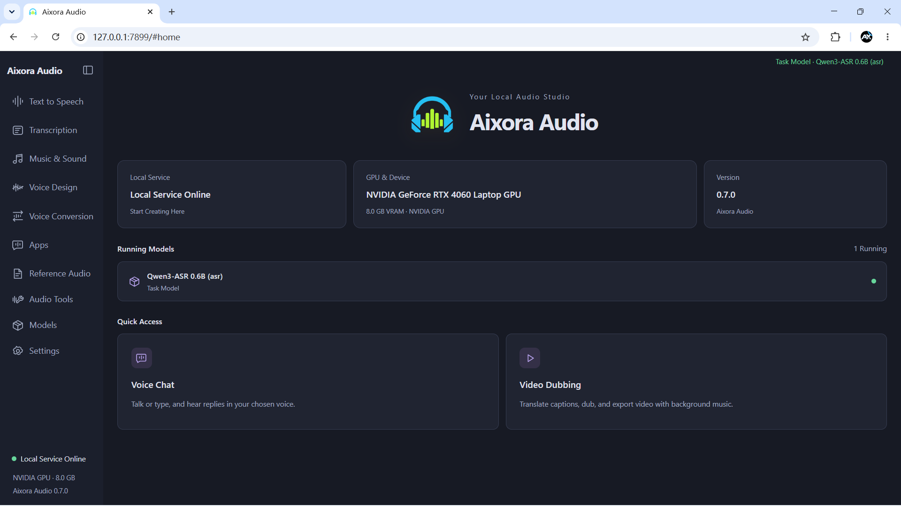

<p align="center">
  
</p>

<h1 align="center">Aixora Audio</h1>

<p align="center"><strong>English</strong> · <a href="README.zh.md">中文</a></p>

<p align="center"><strong>Your local audio studio</strong><br />Speech synthesis · Speech recognition · Music and sound effects · Realtime voice · Video translation and dubbing</p>

> [!IMPORTANT]
> **Aixora Audio 0.7.5 is available**
>
> Realtime voice calls from your phone, more supported models, an updated audio backend and bug fixes.
>
> **[View the 0.7.5 release](https://github.com/kigner/audio.cpp-webui/releases/tag/v0.7.5).** Already using the 0.7.0 portable package? Run **`update.bat`**. For a first installation, download the [complete 0.7.0 package](https://github.com/kigner/audio.cpp-webui/releases/tag/v0.7.0), then run `update.bat`.

<p align="center">
  <a href="webui/README.md">User guide</a> ·
  <a href="#build-the-c-backend-from-source">Build from source</a> ·
  <a href="#set-up-python-and-launch-aixora-audio">Python setup</a> ·
  <a href="#model-support">Model support</a> ·
  <a href="#acknowledgments">Acknowledgments</a>
</p>

Aixora Audio brings local audio models into one workspace. Turn text into voiceovers, transcribe recordings into subtitles, translate and dub videos, or choose a character for a voice conversation. Audio models run locally through the C++ backend; conversation and translation can connect to a local or cloud language model you configure.



## What you can do

| Feature | Workflow |
|---|---|
| Speech synthesis and voice cloning | Enter text, choose a preset voice or reference recording, generate and listen; streaming models can play audio as it is generated |
| Speech recognition and subtitles | Transcribe recordings or videos, inspect timestamps, correct text and export subtitles |
| Video translation and dubbing | Transcribe, translate and review, generate speech per segment, then mix and export with optional background-music preservation |
| Realtime voice chat | Choose a character and voice, then talk on your computer or scan a QR code to call from your phone on the same Wi-Fi; automatic language mode follows the language you speak |
| Global dictation | Dictate into other applications using a shortcut, with recognition status shown in a floating toolbar |
| Music, sound effects and voice design | Generate audio from prompts or lyrics, describe a voice, or convert speech and singing voices |
| Audio tools | Separate vocals and accompaniment, audition stems, enhance and denoise, classify sounds, detect wake words, align text and convert formats |
| Model and reference-audio management | Download, load and remove models, save reference recordings with transcripts, and inspect devices and logs |

## Quick start

1. Extract the complete Windows portable package and double-click **`run_webui.bat`** in its root directory.
2. Once the browser opens at **`http://127.0.0.1:7899`** by default, install the models you need in **Model center**.
3. Open a task page, select and load a model, enter text or upload your material, then generate.
4. Realtime voice chat and global dictation are under **Scenarios**. Configure the service URL, model name and API key in the relevant conversation or translation settings.
5. For phone calls, open **System settings → Mobile access** on your computer, enable mobile access, and scan the QR code with a phone on the same Wi-Fi network.

The portable package includes Python and runtime dependencies. The launcher selects an available backend in **CUDA → Vulkan → CPU** order; you can override it with `AUDIOCPP_BACKEND`. Languages, reference inputs and parameters are shown for the selected model.

To update the portable package, exit the workspace and double-click **`update.bat`**. For everyday use, these are the two entry points. Keep `_env.bat` and `webui/start_webui.bat`: the launcher calls them automatically.

**0.7.0 is a new full-package baseline.** Older packages can still update to 0.6.0 through the legacy channel; install the full **`Aixora-Studio.zip`** to move to 0.7.0. From 0.7.0 onward, updates use GitHub with Hugging Face and hf-mirror as fallbacks. Full packages use the same filename in the [Hugging Face repository](https://huggingface.co/kigner/audio.cpp-webui/tree/main); incremental archives retain their versioned `audiocpp-*` names. See the [updater guide](updater/README.md).

When finished, choose **System settings → Exit workspace service**, or run `run_webui.bat --stop`. Closing the browser leaves the service running.

See the [English guide](webui/README.md) / [中文使用说明](webui/README.zh.md) for detailed instructions. For a source checkout, follow the build and Python setup below.

## Build the C++ backend from source

The main instructions below target **Windows x64 with PowerShell**. To run from source, build the C++ backend first, then set up the Python environment in the next section. The C++ backend performs audio-model inference; Python hosts the Aixora Audio workspace, model downloads, realtime helpers and SpeakType.

### 1. Prepare the tools and source

| Tool | Requirement |
|---|---|
| Git | Used to clone the repository |
| Visual Studio Build Tools 2022 or later | Install **Desktop development with C++**, including MSVC x64, Windows SDK, CMake/Ninja and OpenMP support |
| CMake and Ninja | CMake **3.20 or later**; the build script prefers the tools bundled with Visual Studio and also checks PATH |
| NVIDIA CUDA Toolkit (CUDA builds) | Install the full Toolkit with `nvcc` and an NVIDIA driver supporting your GPU; the driver alone is insufficient for compilation |
| Vulkan SDK (Vulkan builds) | Requires the SDK's `glslc` and a Vulkan-capable GPU driver; CPU builds need neither CUDA nor Vulkan SDK |

```powershell
git clone https://github.com/kigner/audio.cpp-webui.git audio.cpp
cd audio.cpp
```

Run the remaining commands from the repository root. A standard Aixora Audio build uses the vendored dependencies. The optional `external/audio.cpp-server-frontends` submodule is disabled by default, so a recursive submodule checkout is unnecessary for this setup.

### 2. Choose and build a backend

**NVIDIA CUDA:**

```powershell
.\scripts\build_windows.ps1 -Preset windows-cuda-release -Target audiocpp_server -Jobs 16
```

**CPU only:**

```powershell
.\scripts\build_windows.ps1 -Preset windows-cpu-release -Target audiocpp_server -Jobs 16
```

**Vulkan:**

```powershell
.\scripts\build_windows.ps1 -Preset windows-vulkan-release -Target audiocpp_server -Jobs 16
```

Aixora Audio requires `audiocpp_server` for inference. Build the following optional tools for command-line inference or GGUF conversion. These examples use CUDA; replace `-Preset` for another backend:

```powershell
.\scripts\build_windows.ps1 -Preset windows-cuda-release -Target audiocpp_cli -Jobs 16
.\scripts\build_windows.ps1 -Preset windows-cuda-release -Target audiocpp_gguf -Jobs 16
```

Outputs are written to `build/<Preset>/bin/`, for example `build/windows-cuda-release/bin/audiocpp_server.exe`. The source launcher discovers these directories. Keep the source tree intact, especially `model_specs/`, `webui/configs/` and the model-manager scripts.

- `-Jobs 16` controls build parallelism; use `-Jobs 4` if memory is limited.
- CUDA builds detect the local GPU architecture through `nvidia-smi` by default. Use `-CudaArchitectures` to specify a target when building for other devices.
- `-ConfigureOnly` configures without compiling. `-RunTests` also builds and runs the C++ tests.
- The full model set is compiled by default, but backend compatibility varies by model.
- Aixora Audio downloads models through `webui/model_manager_webui.py`; it does not require `-NativeModelManager`. Model management for the upstream native WebUI is a separate feature.

### 3. Linux backend build (optional)

Install a C++17 compiler such as GCC 13+, CMake 3.20+ and Ninja/Make. From the repository root, build the CPU version with:

```bash
bash scripts/build_linux.sh --backend cpu --build-type Release --target audiocpp_server --target audiocpp_cli --target audiocpp_gguf
```

Outputs are written to `build/linux-cpu-release/bin/`. With the appropriate SDK installed, replace `--backend cpu` with `--backend cuda` or `--backend vulkan`. See the next section for running the Python workspace on Linux. SpeakType global dictation targets Windows.

## Set up Python and launch Aixora Audio

### Windows

Install **64-bit Python 3.11** (the project's development environment uses 3.11.9; the commands below use the Windows `py` launcher). After building the backend, run these commands from the repository root:

```powershell
py -3.11 -m venv venv
.\venv\Scripts\python.exe -m pip install --upgrade pip
.\venv\Scripts\python.exe -m pip install -r webui\requirements.txt
.\venv\Scripts\python.exe -m pip check
```

`webui/requirements.txt` includes Python dependencies for Aixora Audio, realtime audio, SpeakType and the model-download tools. Windows desktop packages have platform markers. These commands use the virtual environment's interpreter directly, so `Activate.ps1` is unnecessary. Installing Python packages with pip does not build the C++ backend.

Also install **FFmpeg and FFprobe** and add their executable directory to `PATH`, or place `ffmpeg.exe` and `ffprobe.exe` in `webui/`. They are used for non-WAV conversion, video input and dubbed-video export. A source checkout does not include the Python environment or these tools preinstalled in the portable package.

```powershell
.\run_webui.bat
```

The launcher discovers the root `venv`. Open the URL printed in the startup log, normally `http://127.0.0.1:7860`; use the printed address if you configured a different port. Download a model in **Model center**, then load it on a task page. Model weights are not included in the source checkout.

To select a backend explicitly, set it before launching. Use `cuda`, `vulkan` or `cpu`, and build that backend first:

```powershell
$env:AUDIOCPP_BACKEND = "cpu"
.\run_webui.bat
```

For a Python environment elsewhere, set `AUDIOCPP_PYTHON` to the full path of its `python.exe`. Aixora Audio starts its managed C++ service on port **8088** when needed; you do not need to start a separate backend process for the workspace.

### Linux (optional)

Install Python 3.11 with `venv` support and FFmpeg/FFprobe. Microphone recording also needs the system PortAudio library. After building the backend, run from the repository root:

```bash
python3.11 -m venv venv
./venv/bin/python -m pip install --upgrade pip
./venv/bin/python -m pip install -r webui/requirements.txt
./venv/bin/python -m pip check
AUDIOCPP_BACKEND=cpu ./venv/bin/python webui/webui.py
```

Replace `cpu` in the last line if you built a CUDA or Vulkan backend. Open the workspace URL printed in the terminal and shut down the service from system settings when finished.

### Setup troubleshooting

- **PowerShell blocks the build script:** run `Set-ExecutionPolicy -Scope Process Bypass` in the current window and retry. This setting lasts only for that PowerShell process.
- **Build tools are missing:** check the C++, Windows SDK, CMake/Ninja and OpenMP components in Build Tools; check `nvcc` for CUDA or `glslc` for Vulkan.
- **Server not found:** confirm that `audiocpp_server` was built and that `AUDIOCPP_BACKEND` matches your build.
- **Python modules are missing:** rerun dependency installation and `pip check` with the same `venv`; do not install into a different system Python.
- **Video import or audio conversion fails:** check that FFmpeg/FFprobe are on `PATH` or in `webui/`. For startup issues, read `webui/logs/startup.log` or run `run_webui.bat --diagnostic`.

## Model support

Aixora Audio's Model center includes **129 model families and 184 model entries**. The table below groups them by use. Select a model in the interface to see its versions, languages, reference inputs and parameters.

| Category | Supported models |
|---|---|
| Speech synthesis and voice design | OmniVoice, Pocket TTS, DotTTS (SOAR / MeanFlow / Edit), NeuTTS 2E, Qwen3-TTS (0.6B / 1.7B)<br>MioTTS 1.7B, VoxCPM2, VibeVoice 1.5B, IndexTTS2 / IndexTTS2.5, Irodori-TTS (v4 / v3)<br>MOSS-TTS-Local v1.5, MOSS-TTS-Nano 100M, Supertonic 3, Higgs Audio v3 TTS 4B, Fish Audio S2 Pro<br>GLM-TTS, Llama-OuteTTS 1.0 1B, VieNeu-TTS v3 Turbo, Inflect Micro v2, DramaBox<br>Confucius4-TTS, Habibi / F5-TTS, MagpieTTS Multilingual 357M, Chatterbox, MOSS-VoiceGenerator<br>Audio8 TTS Preview 0.6B, AuK, BreezeTTS 2, Chatterbox Turbo, CosyVoice3<br>Echo-TTS, FireRedTTS3, KittenTTS Mini 0.8, Kitten TTS 2, Kokoro 82M<br>KugelAudio-0-Open, Maya1, MiraTTS, MOSS-TTS-v1.5, MOSS-TTSD<br>Piper TTS, sanoTTS Nano, Soprano, Sopro V2 Turbo, VoxCPM1, ZipVoice<br>Fish Audio Drama 3 / Drama3-small, Ming 3.0 TTS 0.5B, Ming 3.0 Audio Tiny, XTTS v2, Voxtral 4B TTS<br>Plapre 3, LFM2.5-Audio (English / Japanese), FireRedAudio |
| Speech recognition and audio understanding | Qwen3-ASR (0.6B / 1.7B), Citrinet ASR, Nemotron 3.5 ASR 0.6B, Higgs Audio v3 STT, Hviske (v5.3 / v6)<br>VibeVoice ASR, Voxtral Mini 4B Realtime, Fun-ASR-Nano 2512, Parakeet-TDT 0.6B v3, Kroko Community ASR<br>SenseVoice-Small, Audio8-ASR-0.1B, Audio Flamingo 3 / Next, Canary 180M Flash, Cohere Transcribe<br>Confucius4-R2T2, CrisperWhisper 2.0, FireRedAudio, GigaAM ASR, Granite Speech 5.0 470M TurboCTC<br>Index-Echo-S2TT, LFM2.5-Audio (English / Japanese), Moonshine Streaming ASR, MOSS-Transcribe-Diarize, Niagara ASR<br>OWSM, OWSM-CTC, SAMSONE, VibeVoice-ASR-BitNet, VibeVoice ASR Streaming<br>Ming 3.0 Audio Tiny, Whistle ASR |
| Music and sound effects | ACE-Step 1.5, Stable Audio 3 (Small Music / Small SFX / Medium), HeartMuLa 3B, MiniMax-H3, MiniMax Music 3<br>ControlFoley, MiDashengLM-Gen, YuE2 |
| Speech conversation | PersonaPlex, Ming 3.0 Audio Tiny |
| Voice conversion and audio codecs | MeanVC2, Vevo2, Seed-VC, RVC, MioCodec<br>Tone Color VC |
| Source separation | HTDemucs, BS-RoFormer, Mel-Band RoFormer, HTDemucs 6-stem, SAM Audio, MossFormer2, TF-GridNet |
| Audio enhancement and restoration | Apollo, AudioSR, RNNoise, DeepFilterNet2, ZipEnhancer, GTCRN (Streaming / DNS3 / VCTK), FlashSR, RE-USE, Sidon v0.1<br>UniverSR |
| Voice activity and end-of-turn detection | Silero VAD, MarbleNet VAD, PulseVAD, FireRed VAD / Stream-VAD, Smart Turn v3.2 |
| Sound classification | AST AudioSet, CED (Base / Mini / Small / Tiny) |
| Wake-word detection | microWakeWord, OpenWakeWord, Sherpa Zipformer KWS (Chinese / English) |
| Speaker diarization | Sortformer Diarization 4spk, Nemotron 3 Diarization, Sortformer Diarization v2.1 |
| Subtitle and text alignment | Qwen3 Forced Aligner, MMS-300M Forced Aligner |
| Music transcription | MuScriptor Small, SheetSage2 |

Download models from **Model center**. Sound classification and wake-word detection are under **Audio tools**. MiraTTS and Sortformer v2 require manual weight installation.

## Acknowledgments

Aixora Audio's audio inference backend is based on [audio.cpp](https://github.com/0xShug0/audio.cpp). Thanks to ShugoAI LLC and the upstream contributors. This project provides the Aixora Audio workspace, scenario applications, Windows launchers and portable-package updates.

See [LICENSE](LICENSE) for the code license.
