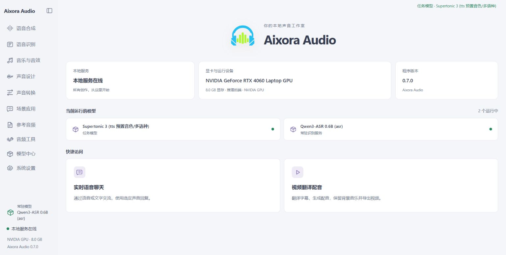

<p align="center">
  
</p>

<h1 align="center">Aixora Studio</h1>

<p align="center"><a href="README.md">English</a> · <strong>中文</strong></p>

<p align="center"><strong>你的本地声音工作室</strong><br />语音合成 · 语音识别 · 音乐与音效 · 实时语音 · 视频翻译配音</p>

> [!IMPORTANT]
> **2026-10-18 · Aixora Studio 0.7.0 全新界面**
>
> 新版工作空间现已加入源码：统一的侧边导航、按任务组织的操作页面，以及字幕制作、视频翻译配音、实时语音聊天和全局语音录入。默认采用 **经典蓝紫＋浅色**，模型、参考音频和运行状态都可以在同一个界面管理。
>
> **v0.7.0 的 GitHub Release 尚未发布。** 待全部完整版整合包下载链接和本版教程视频链接准备就绪后发布；GitHub 当前最新正式 Release 仍为 v0.6.0。

<p align="center">
  <a href="webui/README.zh.md">中文使用说明</a> ·
  <a href="#从源码编译-c-后端">源码编译</a> ·
  <a href="#搭建-python-环境并启动">Python 环境</a> ·
  <a href="#模型支持">模型支持</a> ·
  <a href="#致谢">致谢</a>
</p>

Aixora Studio 把本地音频模型放进一个方便操作的工作空间。输入文字生成配音，把录音转成字幕，为视频翻译和配音，或选择一个角色开始语音对话。音频模型通过 C++ 后端在本机运行；对话与翻译可以连接你配置的本地或云端大语言模型。



## 新版可以做什么

| 功能 | 使用方式 |
|---|---|
| 语音合成与声音克隆 | 输入文字，选择预设音色或参考录音，生成并试听；支持流式模型边生成边播放 |
| 语音识别与字幕 | 转写录音或视频，查看时间戳、校对文本，导出字幕 |
| 视频翻译配音 | 识别原文、翻译校对、逐句配音、混音导出，支持保留背景音乐 |
| 实时语音聊天 | 选择角色和音色，通过麦克风或文字交流；自动语言模式跟随你的说话语言 |
| 全局语音录入 | 在其他应用的输入框里使用快捷键听写，悬浮条显示识别状态 |
| 音乐、音效与声音设计 | 用提示词或歌词生成声音，描述想要的音色，转换说话声和歌声 |
| 音频工具 | 分离人声与伴奏、分轨试听、增强和降噪、对齐文本、转换格式 |
| 模型与参考音频管理 | 下载、加载和删除模型，保存参考录音与原文，查看运行设备和日志 |

本次也改进了实时通话：点击返回会关闭麦克风，再次开麦会复用已加载的对应模型；角色名和音色不会改变自动模式的回复语言。音轨分离结果支持分组波形播放器，视频配音会根据模型显示需要的参考音频设置。

## 快速开始

1. 完整解压 Windows 整合包，双击根目录的 **`run_webui.bat`**。
2. 浏览器默认打开 **`http://127.0.0.1:7899`** 后，进入 **模型中心** 安装需要的模型。
3. 打开功能页，选择并加载模型，输入文字或上传素材，开始生成。
4. 实时语音聊天和全局语音录入都在 **场景应用** 中。对话和翻译服务在相应设置里填写地址、模型名和 API Key。

整合包包含 Python 和运行依赖。启动时会按 **CUDA → Vulkan → CPU** 选择可用后端，也可以通过 `AUDIOCPP_BACKEND` 指定。模型支持的语言、参考输入和参数会随选择显示在页面上。

整合包更新时先退出工作空间，再双击 **`update.bat`**。日常使用只需这两个入口；`_env.bat` 和 `webui/start_webui.bat` 会由启动程序自动调用，请保留。

**0.7.0 是新的完整版基线。** 旧版仍可通过原线路更新到 0.6.0；升级到 0.7.0 请重新安装完整 **`Aixora-Studio.zip`**。0.7.0 起使用 GitHub 主线路，Hugging Face 和 hf-mirror 作为备用。完整版在 [Hugging Face 仓库](https://huggingface.co/kigner/audio.cpp-webui/tree/main) 同名替换，增量包继续沿用带版本号的 `audiocpp-*` 名称。详见 [更新器说明](updater/README.md)。

用完后可在 **系统设置 → 退出工作空间服务** 中退出，或运行 `run_webui.bat --stop`。关闭浏览器窗口后，后台服务会继续运行。

详细操作见 [中文使用说明](webui/README.zh.md) / [English guide](webui/README.md)。从源码运行请继续阅读下面的编译和 Python 环境说明。

## 从源码编译 C++ 后端

以下以 **Windows x64 + PowerShell** 为主。源码运行需要先编译 C++ 后端，再安装下一节的 Python 环境。音频模型推理由 C++ 后端执行，Python 负责 Studio 工作空间、模型下载、实时语音辅助功能和 SpeakType。

### 1. 准备工具与源码

| 工具 | 要求 |
|---|---|
| Git | 用于获取源码 |
| Visual Studio Build Tools 2022 或更新版本 | 安装“使用 C++ 的桌面开发”，包含 MSVC x64、Windows SDK、CMake/Ninja 和 OpenMP 支持 |
| CMake 与 Ninja | CMake **3.20 或更新版本**；构建脚本会优先使用 Visual Studio 随附的工具，也会查找 PATH |
| NVIDIA CUDA Toolkit（CUDA 构建） | 需要带 `nvcc` 的完整 Toolkit，以及支持显卡的 NVIDIA 驱动；仅安装驱动不足以编译 |
| Vulkan SDK（Vulkan 构建） | 需要 SDK 中的 `glslc` 和显卡的 Vulkan 驱动；CPU 构建不需要 CUDA 或 Vulkan SDK |

```powershell
git clone https://github.com/kigner/audio.cpp-webui.git audio.cpp
cd audio.cpp
```

后续命令均在仓库根目录执行。常规 Studio 构建使用仓库内的依赖；可选的 `external/audio.cpp-server-frontends` 子模块默认关闭，无需为此递归拉取子模块。

### 2. 选择一种后端并编译

**NVIDIA CUDA：**

```powershell
.\scripts\build_windows.ps1 -Preset windows-cuda-release -Target audiocpp_server -Jobs 16
```

**仅 CPU：**

```powershell
.\scripts\build_windows.ps1 -Preset windows-cpu-release -Target audiocpp_server -Jobs 16
```

**Vulkan：**

```powershell
.\scripts\build_windows.ps1 -Preset windows-vulkan-release -Target audiocpp_server -Jobs 16
```

`audiocpp_server` 是 Studio 必需的推理服务。需要命令行推理或 GGUF 转换时，再编译对应工具；下面以 CUDA 为例，其他后端替换 `-Preset` 即可：

```powershell
.\scripts\build_windows.ps1 -Preset windows-cuda-release -Target audiocpp_cli -Jobs 16
.\scripts\build_windows.ps1 -Preset windows-cuda-release -Target audiocpp_gguf -Jobs 16
```

输出位于 `build/<Preset>/bin/`，例如 `build/windows-cuda-release/bin/audiocpp_server.exe`。源码启动器能够发现这些目录。请保留完整源码目录，尤其是 `model_specs/`、`webui/configs/` 和模型管理脚本。

- `-Jobs 16` 是并行编译数，内存不足时可降为 `-Jobs 4`。
- CUDA 构建默认通过 `nvidia-smi` 检测本机显卡架构；为其他设备构建时可用 `-CudaArchitectures` 指定目标。
- `-ConfigureOnly` 仅配置；`-RunTests` 会额外构建并运行 C++ 测试。
- 默认编译完整模型集，但各模型的后端兼容性不同，请以所选模型的支持情况为准。
- Studio 使用 `webui/model_manager_webui.py` 管理下载，无需为它启用 `-NativeModelManager`。上游原生 WebUI 的模型管理是独立功能。

### 3. Linux 后端编译（可选）

准备 C++17 编译器（例如 GCC 13+）、CMake 3.20+ 和 Ninja/Make。以下从仓库根目录编译 CPU 版本：

```bash
bash scripts/build_linux.sh --backend cpu --build-type Release --target audiocpp_server --target audiocpp_cli --target audiocpp_gguf
```

输出位于 `build/linux-cpu-release/bin/`。安装相应 SDK 后，可将 `--backend cpu` 改为 `--backend cuda` 或 `--backend vulkan`。Python 工作空间的 Linux 启动方法见下一节；SpeakType 全局语音录入面向 Windows。

## 搭建 Python 环境并启动

### Windows

安装 **64 位 Python 3.11**（本项目开发环境为 3.11.9，下面使用 Windows 的 `py` 启动器）。在已经编译好后端的仓库根目录执行：

```powershell
py -3.11 -m venv venv
.\venv\Scripts\python.exe -m pip install --upgrade pip
.\venv\Scripts\python.exe -m pip install -r webui\requirements.txt
.\venv\Scripts\python.exe -m pip check
```

`webui/requirements.txt` 包含 Studio、实时语音、SpeakType 和模型下载工具的 Python 依赖；其中 Windows 桌面依赖带有平台条件。上述命令直接使用虚拟环境解释器，无需执行 `Activate.ps1`。pip 安装 Python 包不会编译 C++ 后端。

另外安装 **FFmpeg 和 FFprobe**，将其可执行文件所在目录加入 `PATH`；也可以把 `ffmpeg.exe` 和 `ffprobe.exe` 放在 `webui/` 下。它们用于非 WAV 音频转换、视频读取和配音导出。源码检出不包含整合包中预装的 Python 环境及这些工具。

```powershell
.\run_webui.bat
```

启动器会发现根目录的 `venv`。打开启动日志给出的地址，默认是 `http://127.0.0.1:7860`；如果设置了自定义端口，请以日志为准。在 **模型中心** 下载模型，再到功能页加载。源码不包含模型权重。

需要固定后端时，在启动前设置（值可为 `cuda`、`vulkan` 或 `cpu`，须已编译对应版本）：

```powershell
$env:AUDIOCPP_BACKEND = "cpu"
.\run_webui.bat
```

使用其他位置的 Python 环境时，设置 `AUDIOCPP_PYTHON` 为其 `python.exe` 的完整路径。Studio 按需在 **8088** 端口启动受管理的 C++ 服务；使用工作空间时无需另开一个后端进程。

### Linux（可选）

准备 Python 3.11 和其 `venv` 支持、FFmpeg/FFprobe；麦克风录音还需要系统 PortAudio 库。完成后端编译后，在仓库根目录执行：

```bash
python3.11 -m venv venv
./venv/bin/python -m pip install --upgrade pip
./venv/bin/python -m pip install -r webui/requirements.txt
./venv/bin/python -m pip check
AUDIOCPP_BACKEND=cpu ./venv/bin/python webui/webui.py
```

如已编译 CUDA 或 Vulkan 后端，将最后一行的 `cpu` 改为相应值。打开终端给出的工作空间地址，退出前在系统设置中关闭服务。

### 常见搭建问题

- **PowerShell 阻止运行编译脚本：** 可在当前窗口执行 `Set-ExecutionPolicy -Scope Process Bypass`，然后重试；该设置仅对当前 PowerShell 进程有效。
- **找不到编译工具：** 检查 Build Tools 的 C++、Windows SDK、CMake/Ninja 和 OpenMP 组件；CUDA 检查 `nvcc`，Vulkan 检查 `glslc`。
- **找不到 server：** 确认已编译 `audiocpp_server`，且 `AUDIOCPP_BACKEND` 与编译版本一致。
- **缺少 Python 模块：** 使用同一个 `venv` 重新执行依赖安装和 `pip check`；不要将包安装到另一个系统 Python。
- **无法导入视频或转换音频：** 检查 FFmpeg/FFprobe 是否在 `PATH` 或 `webui/` 下。启动问题可查看 `webui/logs/startup.log`，或运行 `run_webui.bat --diagnostic`。

## 模型支持

Studio 模型中心提供 **113 个模型家族、157 个模型条目**。下表按主要用途列出支持的模型；具体版本、语言、参考输入和参数可在界面中查看。

| 类别 | 支持的模型 |
|---|---|
| 语音合成与声音设计 | OmniVoice、Pocket TTS、DotTTS（SOAR / MeanFlow / Edit）、NeuTTS 2E、Qwen3-TTS（0.6B / 1.7B）<br>MioTTS 1.7B、VoxCPM2、VibeVoice 1.5B、IndexTTS2 / IndexTTS2.5、Irodori-TTS（v4 / v3）<br>MOSS-TTS-Local v1.5、MOSS-TTS-Nano 100M、Supertonic 3、Higgs Audio v3 TTS 4B、Fish Audio S2 Pro<br>GLM-TTS、Llama-OuteTTS 1.0 1B、VieNeu-TTS v3 Turbo、Inflect Micro v2、DramaBox<br>Confucius4-TTS、Habibi / F5-TTS、MagpieTTS Multilingual 357M、Chatterbox、MOSS-VoiceGenerator<br>Audio8 TTS Preview 0.6B、AuK、BreezeTTS 2、Chatterbox Turbo、CosyVoice3<br>Echo-TTS、FireRedTTS3、KittenTTS Mini 0.8、Kitten TTS 2、Kokoro 82M<br>KugelAudio-0-Open、Maya1、MiraTTS、MOSS-TTS-v1.5、MOSS-TTSD<br>Piper TTS、sanoTTS Nano、Soprano、Sopro V2 Turbo、VoxCPM1<br>ZipVoice |
| 语音识别与音频理解 | Qwen3-ASR（0.6B / 1.7B）、Citrinet ASR、Nemotron 3.5 ASR 0.6B、Higgs Audio v3 STT、Hviske v5.3<br>VibeVoice ASR、Voxtral Mini 4B Realtime、Fun-ASR-Nano 2512、Parakeet-TDT 0.6B v3、Kroko Community ASR<br>SenseVoice-Small、Audio8-ASR-0.1B、Audio Flamingo 3 / Next、Canary 180M Flash、Cohere Transcribe<br>Confucius4-R2T2、CrisperWhisper 2.0、FireRedAudio、GigaAM ASR、Granite Speech 5.0 470M TurboCTC<br>Index-Echo-S2TT、LFM2.5-Audio（英语 / 日语）、Moonshine Streaming ASR、MOSS-Transcribe-Diarize、Niagara ASR<br>OWSM、OWSM-CTC、SAMSONE、VibeVoice-ASR-BitNet、VibeVoice ASR Streaming |
| 音乐与音效 | ACE-Step 1.5、Stable Audio 3（Small Music / Small SFX / Medium）、HeartMuLa 3B、MiniMax-H3、MiniMax Music 3<br>ControlFoley、MiDashengLM-Gen、YuE2 |
| 语音对话 | PersonaPlex |
| 声音转换与音频编码 | MeanVC2、Vevo2、Seed-VC、RVC、MioCodec<br>Tone Color VC |
| 音轨分离 | HTDemucs、BS-RoFormer、Mel-Band RoFormer、HTDemucs 六轨版、SAM Audio |
| 音频增强与修复 | Apollo、AudioSR、RNNoise、DeepFilterNet2、ZipEnhancer、GTCRN（Streaming / DNS3 / VCTK）、FlashSR、RE-USE、Sidon v0.1<br>UniverSR |
| 语音检测与对话结束判断 | Silero VAD、MarbleNet VAD、PulseVAD、Smart Turn v3.2 |
| 说话人分离 | Sortformer Diarization 4spk、Nemotron 3 Diarization、Sortformer Diarization v2.1 |
| 字幕与文本对齐 | Qwen3 Forced Aligner、MMS-300M Forced Aligner |
| 音乐转谱 | MuScriptor Small、SheetSage2 |

在 **模型中心** 选择并下载模型。MiraTTS 与 Sortformer v2 的权重需要手动安装。

## 致谢

Aixora Studio 的音频推理后端基于 [audio.cpp](https://github.com/0xShug0/audio.cpp)。感谢 ShugoAI LLC 与上游贡献者；本项目提供 Studio 工作空间、场景应用、Windows 启动和整合包更新。

代码许可见 [LICENSE](LICENSE)。
