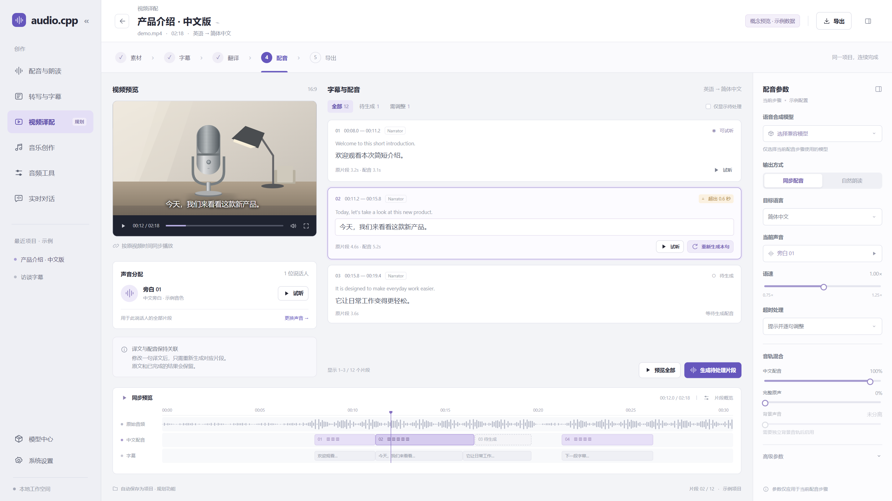

# audio.cpp WebUI 场景工作区与交互改造需求

日期：2026-10-06。版本：B–D 实施记录版。状态：整体效果图已获用户确认，本轮按授权实施 B–D；E–G 留待后续。已有源码改造与自动检查不等于真实模型、麦克风或完整工作流已经验收，证据和边界见第 12.4 节。

继续以本地 Web 应用运行。信息结构采用“场景入口 + 独立工具”：左侧按用户想完成的事情分类，页面内部围绕素材、文本、声音及输出组织；多步骤处理留在同一项目中。保留配音、转写、音乐与工具的单项使用方式，同时为自动字幕、字幕翻译、中文朗读及视频译配规划完整路径。实时语音以主界面微调和接入文字输入为限。现有 Python 服务、模型管理和 C++ 推理能力继续复用。此前的 Qt6 迁移方案及绿色原型不作为本次实施基线。

本文面向产品确认与开发落地，将已有能力、界面改造和后续功能分别列出。用户已确认完整效果图并授权开始实施，随后明确先完成 B–D：工作台骨架、已有能力工作区、启动与实时调整。项目存储、自动字幕、字幕翻译和视频译配属于 E–G，本轮不实现。第 14 节效果图选中“视频译配”，是已经确认的完整目标结构，仍不是当前软件运行截图；正式界面不展示未接通的视频译配和最近项目入口。

## 1 需求与本次设计约束

| 编号 | 要求 | 落地含义 |
| --- | --- | --- |
| R01 | 保留 Web 运行方式 | 继续使用浏览器与本地服务，不引入 Qt6、桌面壳或新的推理框架 |
| R02 | 场景直接进入左侧菜单 | 配音与朗读、转写与字幕、音乐创作成为一级入口；为视频译配预留同级场景，取消原有七类能力横向主导航 |
| R03 | 工具集中到一个页面 | 声音转换、音源分离、音频分析、声音设计等由“音频工具”统一进入，保留各自能力与结果形式 |
| R04 | 左侧菜单可以收缩 | 展开时显示图标与名称，收缩后保留图标、提示和选中状态 |
| R05 | 设置分为两类 | 系统设置紧跟左侧功能菜单进入独立页面；当前任务参数在右侧可收缩面板中 |
| R06 | 模型入口属于任务或步骤 | 单项任务放内容区顶部；多步骤项目放当前步骤参数栏，识别、翻译、合成分别配置，不占据应用公共顶部 |
| R07 | 借鉴 LM Studio 的选择器样式 | 使用搜索框、紧凑模型行、状态和必要规格；不照搬全局加载一个模型的交互语义 |
| R08 | 围绕处理对象重组 | 借鉴 Voicebox 的对象与内容布局，围绕素材、文本、声音、片段和结果组织；多步骤处理属于同一项目 |
| R09 | 删除广告式文案 | 页面只保留功能名、字段名、操作名和必要的限制说明，移除宣传标题与重复介绍 |
| R10 | 实时语音做小幅调整 | 左上角只留返回图标；减少顶部操作；麦克风浮窗偏左；会话参数仍从右侧展开 |
| R11 | 重新设计颜色 | 绿色不再作为默认主色；提出适合音频工具的中性色与克制强调色 |
| R12 | 整理启动窗口 | 明确多余 PowerShell 的来源；可后台运行的进程隐藏窗口，同时保留日志、错误反馈和退出方式 |
| R13 | 实时语音中可展开文字聊天 | 直接复用已接入的本地或云端 API、模型、角色提示和会话上下文，无需另配一套聊天服务 |
| R14 | 现在规划字幕与译配场景 | 设计自动字幕、已有字幕翻译、译文朗读和同步中文配音的入口、步骤与输出；实施阶段另列 |
| R15 | 同项目连续处理 | 素材、原文、译文、声音分配和配音片段关联保存，支持跨场景继续处理，不要求手动搬运结果 |
| R16 | 区分朗读与同步配音 | 自然朗读优先表达；同步配音按视频时间处理句段、停顿和超时，不把全文 TTS 等同于视频译配 |
| R17 | 完整应用效果图 | 展示全部一级导航、项目页头、步骤栏、媒体与文本工作区、上下文参数和同步预览；标明概念与示例数据 |
| R18 | 规划功能按能力落地 | 正式界面只开放已经实现并验收的动作；概念图中的视频译配、最近项目和自动保存不能被当成已发布能力 |

文字聊天作为实时语音的另一种输入方式，纳入此次方案。实施重点是把文字送入现成的对话调用链路，见第 8 节。

### 1.1 产品分类与典型场景

选择本方案的场景导航作为长期结构，不继续扩充原七标签。左侧回答“要完成什么”，步骤栏回答“当前处理哪一步”，模型与参数回答“这一步如何处理”。技术任务类型继续用于能力过滤与执行路由，不要求与用户菜单一一对应。

| 用户目标 | 主入口 | 处理路径 | 交付物与能力边界 |
| --- | --- | --- | --- |
| 给文案配音或朗读文章 | 配音与朗读 | 文本 → 声音 → 生成 → 试听 | 复用现有 TTS；长文章分段、工程保存等按实际能力另接 |
| 把录音转成文字 | 转写与字幕 | 音频或录音 → 转写 → 复制或导出 | 复用现有 ASR、TXT 和详细结果；不自动承诺统一字幕编辑器 |
| 给音视频自动生成字幕 | 转写与字幕 | 素材 → 识别与时间映射 → 校对 → 导出 | 视频导入、规范化字幕段、SRT/VTT 导出属于后续完整链路 |
| 把已有外语字幕翻成中文 | 转写与字幕 | 导入字幕 → 翻译 → 对照校对 → 导出 | 跳过 ASR；字幕导入、翻译和编辑待实施；视频画面中的烧录字幕 OCR 暂不纳入 |
| 听一份译文的中文朗读 | 配音与朗读，或字幕结果中的继续操作 | 校对译文 → 自然朗读 → 试听 | 不强制视频时长；跨场景传递与译文生成待实施 |
| 制作同步中文配音视频 | 视频译配 | 素材 → 字幕 → 翻译 → 配音 → 导出 | 后续新增项目工作流，含逐句时长检查、混音和视频输出 |
| 单独换声、分离或检测音频 | 音频工具 | 选择工具 → 素材 → 处理 → 结果 | 保持已有工具独立入口；也可被项目步骤按需调用 |

首版场景工作流采用固定步骤与明确的继续动作，不增加自由拖拽节点的通用工作流编辑器。翻译、混音和视频导出属于项目步骤，不各建一个一级菜单。

## 2 从 Voicebox 参考中提取的结构

截图体现的是“全局导航—对象选择—内容操作—上下文参数”的分工。不同页面根据处理对象改变布局，统一的是导航和控件语言，而不是强制套用相同的输入卡片与结果卡片。

| 参考页面 | 截图中的布局与交互 | 在本项目中的应用 |
| --- | --- | --- |
| Voicebox 配音 | 左侧窄导航；音色卡片；右侧生成记录；输入区固定在内容区底部 | TTS 以音色和文本输入为核心，生成结果形成可连续试听的列表，输入区不会随结果增长被挤走 |
| 故事 | 全局导航旁是项目列表；中间是可编辑段落；底部输入与音轨区域 | 借鉴“当前对象”和“编辑区”分离、操作靠近内容；多角色故事、拖拽编排与多轨时间线不随本轮自动加入 |
| 捕获与转写 | 左侧录音历史；主区先显示波形，再显示原始或精修文本，操作跟随文本 | ASR 使用录音列表与转写详情结构，上传或录音后直接进入波形与文本工作区 |
| 声音 | 主区音色列表；选中音色后，右侧显示名称、语言、样本等 | 借鉴选中对象驱动右侧面板；先复用已有声音资源，完整音色库增删改另列能力扩展 |
| 效果 | 左侧预设列表；主区展示选中预设详情 | 工具页先选择工具，再显示该工具输入与结果；不让所有工具的表单同时堆在一页 |
| 模型 | 独立的分类模型列表与下载状态 | 模型中心继续承担安装、下载与检查；任务页只负责选用适配模型 |
| 系统设置 | 左侧齿轮进入独立设置页，内部按类别组织表单 | 系统公共设置保留独立页面；模型采样、识别语言等当前任务参数放右侧 |
| 下载提示 | 跨页面持续显示下载进度 | 保留跨页面状态可见性，但收敛为小型进度入口，避免大浮窗长期覆盖内容 |

不复制参考软件中的模型数量、引擎支持、精修能力、MCP、快捷听写等产品承诺。概念预览可展示本文明确规划的能力并标注；正式运行界面仅开放实现并验收的功能。单项结果记录与可恢复的多步骤项目必须区分。

## 3 改造前基线与本轮范围

改造前默认入口已经是自定义 HTML、CSS、JavaScript 工作台。`webui/webui.py` 默认调用 `launch_workbench()`；旧 Gradio 页面是显式设置 `AUDIOCPP_WEBUI_LEGACY=1` 时的兼容入口。因此本次主要工作是重组现有前端与补足页面状态管理，不是从 Gradio 重新建设整套后端。下表保留改造前的问题与工作范围；本轮源码状态另见第 12.4 节，不能将旧结构当作改造后的当前界面。

| 部分 | 改造前结构 | 改造范围 |
| --- | --- | --- |
| 工作台导航 | 全局“工作台”入口加横向七类任务标签 | 中等，涉及路由、导航、浏览器返回、每页状态保留 |
| TTS、ASR、音乐工作区 | 通用输入表单、结果卡片和右侧模型设置列 | 较大，需要按任务分别设计内容区及结果交互 |
| 参数与模型选择 | 下拉模型框位于右栏，普通字段与参数混排 | 中等，需要模型选择器、参数分组、独立状态和重载提示 |
| Python 与 C++ 执行链 | 工作台适配层调用现有任务函数和模型服务 | 以复用为主，按新增状态或能力补充接口 |
| 实时语音外观 | 独立场景页、底部麦克风、右侧设置与记录 | 小范围，优先保留语音处理和会话生命周期 |
| 启动体验 | BAT 前台运行 Python，模型子进程按需启动 | 单独处理进程归属、隐藏、日志与退出 |
| 实时文字输入 | 已有本地或云端 LLM API 配置、上下文与流式调用 | 补接输入入口和轮次调度，复用现有对话能力 |
| 项目保存与恢复 | 当前缺少跨重启列表与产物恢复接口 | 单项页面可先用会话记录；完整字幕和译配工作流必须先具备项目存储 |
| 自动字幕与字幕翻译 | 现有 ASR 与对齐可作为部分基础，不等于完整字幕产品 | 新增字幕导入、规范化片段、校对、翻译与导出链路 |
| 视频译配 | 尚不能由当前七任务页面直接完成整条项目链路 | 新增项目编排、逐句配音、同步检查、混音与视频输出 |

本轮按 B–D 重组已有能力，复用现有推理服务。完整字幕、翻译和视频译配还涉及项目数据、服务接口和媒体处理；项目存储必须在这些场景工作流上线前完成。新增需求如涉及 C++ 仍遵守编译门槛，portable 同步、提交、打包和发布不随本轮界面实施自动执行。

## 4 导航与空间分配

### 4.1 一级导航

目标结构的左侧从上到下排列；已确认效果图展示完整目标结构，B–D 正式界面暂不开放标为规划的两项：

```text
收缩或展开
配音与朗读
转写与字幕
视频译配          [规划；正式版按实现状态开放]
音乐创作
音频工具
实时对话
模型中心
系统设置

最近项目          [项目存储实现后开放]
```

“模型中心”和“系统设置”紧跟实时对话，按同一组菜单连续排列，不再单独沉到左下角。左下角仅保留服务状态、硬件及版本信息：本地服务提示位于显卡信息的分隔线上方，在线为绿色小圆点，离线为红色小圆点，并保留文字或悬停提示。现有 API 文档归入“系统设置 / API 与开发”，保留旧入口跳转兼容。首次进入“配音与朗读”；此后恢复最近使用的有效场景。项目恢复能力实现后，可以回到上次项目及步骤，但不能自动启动生成或麦克风。

“转写与字幕”交付文字和字幕，“视频译配”交付同步配音视频。前者的“继续制作配音”直接携带同一项目的素材和字幕进入后者；不复制一套独立字幕数据，也不要求重新上传。只需独立朗读时，选择“生成自然朗读”，转到同项目的配音输出视图。

一级名称用中文场景词，TTS、ASR 仅作为模型或帮助中的辅助标识。生产界面未实现视频译配时隐藏该运行入口，不放可点击却无法执行的功能；概念预览中可用“规划”标记展示目标结构。“最近项目”是少量近期项目快捷入口，不再增加一个与各场景竞争的“工作台”功能分类；没有持久化能力时不显示伪造项目记录。

左侧导航展开宽度为 232 px，收缩为约 64 px 的图标栏。使用一致的线性图标，避免混用彩色 Emoji。仅图标状态保留悬停名称、键盘焦点、当前页面提示及服务圆点。

### 4.2 任务页骨架

```text
[左栏开关] 品牌 │ 任务标题 [模型选择 ▾] [加载模型] 模型状态  [右栏开关]
──────────────────────────────────────────────────────────────────────
左侧导航       │ 当前任务内容区，按 TTS、ASR、音乐组织    │ 任务参数
               │ 输入操作、结果播放与导出                  │ 可收缩
```

以上骨架用于单项任务：顶部为横贯整个窗口的完整工具栏，下方为左侧导航、中间任务内容、右侧任务参数三栏。左右收缩图标分列顶栏两端。模型选择器属于当前任务；加载按钮右侧显示“模型待加载”，加载后显示后端实际模型 ID，可直接用于 API 请求的 `model` 字段，不使用模型的展示别名替代。加载配置变化仍显示需重载状态。进入系统设置、模型中心、音频工具首页时不显示“当前推理模型”，进入具体工具后才显示该工具的模型。服务连接状态继续放左下角，不另设公共顶部状态行。

多步骤项目采用同一应用外框，内容区改为：

```text
左侧场景导航 │ 项目名称、素材与语言方向             [导出] [参数]
             ├──────────────────────────────────────────────────
             │ 素材 → 字幕 → 翻译 → 配音 → 导出
             ├───────────────────────────────────┬──────────────
             │ 媒体预览 │ 当前步骤的文本或片段编辑 │ 当前步骤参数
             │ 声音分配 │ 局部试听、重做及状态     │ 步骤模型选择
             ├───────────────────────────────────┤ 可收缩
             │ 与当前素材对应的同步播放与片段概览 │
```

横向导航只表示当前项目的处理步骤，不再重复全局能力分类。素材和项目身份在切换步骤时保持；页头没有代表整条流程的“总模型”。简短单项配音不强制出现步骤栏、视频预览或时间轨道。

右侧参数栏宽度为 320 px。唯一开关位于任务顶栏最右侧，悬停及无障碍名称随状态显示“展开任务参数”或“收起任务参数”。收起后内容区占满右侧释放的宽度，不保留图标竖条或空白列。窄屏改为顶栏下方的抽屉，仍由顶栏的同一个开关控制。参数栏标题随任务或项目步骤显示为“配音参数”“转写参数”“翻译参数”“导出设置”“音乐参数”或具体工具参数。

常规任务首次进入默认展开参数栏，此后分别记忆收缩状态；实时语音默认收起。导航、素材列表、参数栏是三个独立区域，不能使用一个“收缩”开关同时控制。

### 4.3 窗口缩小时的规则

优先保住主要内容宽度：先收缩导航，再把参数栏变为右侧抽屉；ASR 的录音列表可以单独收缩。译配页在中等宽度下将视频预览缩为可展开区，保留片段编辑；窄屏将媒体与编辑区上下排列，同步轨道可收起。不能像当前窄屏布局那样，把整组设置搬到输入区上方。小屏同一时间只展开一个覆盖式侧栏，抽屉关闭后恢复触发按钮焦点。

预览至少检查 1920×1080、1440×900、1280×720 和 390 px 窄屏，并覆盖 125% 与 150% 浏览器缩放。固定输入区、字幕和播放器不得互相遮挡。

## 5 各任务的布局与操作顺序

### 5.1 配音与朗读

建议采用“音色与输入—生成记录”的工作区。宽屏时主区内部左侧安排当前音色、参考声音和文本输入，右侧安排生成记录；最右侧可收缩栏只放任务参数。参数栏展开或窗口缩小时，记录区与输入区按可用宽度调整，不强制维持拥挤的四列。

常用文本输入区靠内容区底部，主操作只保留“生成语音”。文本、参考音频及其原文属于本次素材，放在主内容区；语言、语速、表达方式、流式输出和采样参数属于任务设置。音色选择可以在输入区显示紧凑入口，但必须与右侧相关参数共享同一份状态，不能形成两份互相覆盖的配置。

操作顺序：进入配音 → 选择兼容模型 → 选择内置音色或参考声音 → 输入文本 → 生成 → 试听或导出。模型已有记忆且素材齐备时可直接输入并生成，不要求每次逐步点击。

结果行显示文本摘要、音色、模型、时长和状态，直接提供播放与下载；其余动作放“更多”。生成过程中保留输入和已有结果。模型不支持参考声音、指令或流式时，不展示对应控件；需要参考原文时必须在输入旁给出校验。

音色卡片先表示当前模型可用的内置声音与已有参考文件。不要把“克隆新音色并长期管理”的完整流程伪装成已经实现的普通选择框。

未来从字幕译文进入时，应保留所属项目和译文版本，允许选择朗读全部或部分片段；默认“自然朗读”，不绑定原视频时长。普通手工输入文本仍可直接生成，不能为了项目化而强制用户先建立空项目。超出模型文本限制时如尚无分段处理能力，继续明确提示限制，不以“文章朗读”名称暗示无限长度。

### 5.2 转写与字幕

```text
转写与字幕        [识别模型 ▾]                         [参数]
────────────────────────────────────────────────────────────
录音列表          │ 文件名、音频播放器与波形            │ 识别语言
上传或录音        │                                    │ 识别模式
当前会话记录      │ 转写文本或分段结果                  │ 专有名词
                  │                                    │ 高级参数
                  │ 复制  导出  重新转写                │
```

入口动作是“添加音频”或“录音”，不再使用“添加音频转文字”这类把素材动作与处理结果混在一起的标签。文件添加完成后，主区显示音频信息与转写区，主要操作为“开始转写”。已有结果时，波形、原始音频和文本始终对应同一个记录。

普通文本、带时间戳的详细结果、说话人模式和流式模式按照当前能力显示，并保留已有互斥规则。只有后端提供时间映射时才支持点击文字定位音频；不从纯文本推算伪时间戳。

Voicebox 的“原始 / 精修”切换不直接搬入：当前没有统一的转写精修链路。首轮布局改造完整保留复制、TXT 和已有详细结果文件导出；下列字幕编辑与翻译属于后续工作流阶段，不能仅通过按钮改名宣称支持。

后续字幕工作区按输入类型进入：

- 音频或视频：读取媒体信息，选择音轨，识别并获得有效时间映射；视频抽取音轨与预览需要真实媒体接口。
- 已有 SRT/VTT：导入原文与时间轴，校验格式和范围，跳过 ASR。嵌入视频的可提取字幕轨需另验收；仅存在于画面像素中的烧录字幕不视为可直接导入。
- 纯文本：可用已有“字幕对齐”能力结合音频生成时间映射；只有纯文本而无音频时，不生成伪时间戳。

工作区包含媒体预览、片段列表、原文与译文对照，以及随步骤变化的参数。用户能校对文字、调整片段边界和合并或拆分字幕；原始识别文本保留可追溯版本。字幕翻译使用稳定片段 ID 关联译文，跨句上下文可供翻译参考，返回结果不得丢段或任意改变时间轴。翻译连接可复用服务配置，但不能混入实时聊天的角色提示与会话历史。

输出动作按实际实现开放：复制文本、导出 TXT、原文字幕、中文字幕或双语字幕；继续操作为“生成自然朗读”或“继续制作配音”。字幕文件输出与烧录字幕的视频输出是不同交付物，后者进入视频导出阶段。字幕导出需校验时间顺序、编码、空段和越界，并让用户选择单语或双语。

### 5.3 音乐创作

音乐页围绕一份创作输入和其生成版本组织。主区上部是紧凑的创作方式入口，中心为音乐描述、歌词或源音频编辑区；生成结果以版本列表配合播放器展示。右侧参数栏放时长、种子及模型支持的生成控制。

操作顺序：选择模型与其支持的创作方式 → 填写描述、歌词或添加源音频 → 调整参数 → 生成 → 试听、比较、导出。纯音乐、带歌词生成、续写、翻唱、编辑等只在模型实际支持时出现；不能把某个模型的能力做成所有模型通用的标签。

“描述”“歌词”“源音频”是内容编辑入口，而不是并列的功能广告卡。源音频只在相应模式展示或展开；必填条件由模型 profile 决定。单轨波形用于试听和定位，不增加可拖动但不能真正编辑的装饰时间线。

保留后端返回的全部文件。音乐音频、MIDI、乐谱、JSON 等按真实产物显示名称与类型，不能为了统一播放器布局只保留第一个音频。

### 5.4 音频工具

工具首页是紧凑的分类目录。选中具体工具后，切换到“素材—结果—参数”详情，模型选择器随该工具出现。保留“返回工具”入口和该工具的输入草稿。

| 工具分组 | 现有任务与能力映射 | 主区组织 |
| --- | --- | --- |
| 声音转换 | `vc`、`svc`、`s2s`，按模型实际用途区分声音转换、歌声转换或音频处理 | 源音频与目标声音，随后是结果对照；不能将所有 `s2s` 模型统一标为换声 |
| 音源分离 | `sep`，包括支持文本提示的分离 | 源音频、必要的提取目标、多轨或多 stem 输出 |
| 声音设计 | `vdes` | 音色描述、试听文本、生成声音 |
| 检测与分析 | `vad`、`diar`、`turn` 等 | 音频加检测区间、说话人或结构化结果 |
| 字幕对齐 | `align` | 音频与原文，随后是对齐结果及导出 |
| 乐谱提取 | `midi` | 音频输入与 MIDI、乐谱等结果文件 |

这里的“整合”是入口统一，不是压成一个万能表单。每个工具保留自己的输入、模型过滤、参数及产物展示。模型中心可以使用同一工具分类进行筛选。

本轮工具目录按已有任务映射提供入口，已移除原先没有对应后端映射的 `spk` 分类；说话人区分使用现有 `diar`，不把它标成说话人身份识别。以后新增工具仍须同时核对 catalog、能力字段与执行路由。

工具可被项目调用，例如在译配中提取背景声，或在字幕中补做对齐。由场景调用时，结果作为当前项目的派生产物回填，完成后仍回到原步骤；从音频工具直接进入时保持独立使用。不要因为工具被工作流复用而删除其单项入口。

### 5.5 视频译配（后续新增场景）

视频译配是完整项目工作区，不是新增一张 TTS 表单。目标为在同一项目内完成外语视频的中文字幕和中文配音；首版不包含口型驱动、人物视频生成或通用视频剪辑器。

| 步骤 | 主内容与动作 | 右侧上下文参数 | 可跳过条件 |
| --- | --- | --- | --- |
| 素材 | 导入视频、确认源音轨、关联已有字幕 | 媒体与音轨信息 | 从现有项目进入可直接复用 |
| 字幕 | 识别、检查时间映射、校对原文 | ASR 或对齐模型、源语言及适配选项 | 已有有效字幕时跳过识别 |
| 翻译 | 原文与中文对照、术语设置、校对译文 | 翻译模型或连接、目标语言、翻译规则 | 已有中文译文或无需翻译时跳过 |
| 配音 | 说话人声音分配、逐句生成、试听和超时检查 | TTS 模型、同步方式、语速与适配选项 | 只需要字幕时无需生成配音 |
| 导出 | 检查缺失或过期片段、混音试听、导出 | 视频/音频格式、字幕方式与音轨电平 | 可随时导出当前已有效完成的字幕或音频 |

步骤可返回编辑，不强制每次从头运行；继续执行前检查必需输入。首次使用必须配置有效模型或连接，之后可恢复兼容配置。不要浏览一个步骤就自动下载或加载模型。

“配音”步骤有两种输出方式：

- **同步配音**：目标是与原视频时间对应。每句显示原片段时长、生成时长及差值，区分可试听、待生成、超时、失败和已过期。提供修改译文、调整受支持语速、重新生成本句等处理；任何自动压缩或拉伸都需明确策略和质量边界。片段间隔、重叠及原始空白时间必须可检查，不只把所有音频首尾相接。
- **自然朗读**：目标是独立音频的自然表达，可使用校对后的译文，允许总时长与视频不同。输出音频并明确不保证视频同步；不沿用同步完成标记。换模式后保留文本与声音配置，相关产物按模式分别保存。

宽屏主区左侧为视频预览和声音分配，右侧为双语片段编辑及局部试听，最右为可收缩的当前步骤参数。底部为原音频、中文配音和字幕的同步播放概览，片段选中、播放器和字幕行保持关联。首版以定位、试听和检查为目的；不能出现实际不能编辑的拖拽手柄，也不扩成 DAW 多轨剪辑器。

“说话人分离/区分”只提供片段归属，不等于已经知道人的身份或自动拥有对应克隆音色。声音分配默认使用适配模型的已可用声音；参考声音和参考原文依模型需求校验，多人重叠段需提示处理。切换声音只影响被分配给它的片段。

混音必须区分原始混合音轨、中文配音和独立背景音轨。没有独立背景声时，不提供能单独调低“原始人声”而保留背景的假滑块；可以使用完整原声电平，或先执行支持的音源分离。分离结果需试听，不能承诺无损去除人声。

最终可规划导出中文字幕/双语字幕、独立中文音轨和含中文配音的视频；软字幕、烧录字幕、封装/编码选择依媒体处理实现提供。导出应使用已确认的项目修订版，检查缺失、失败和已过期片段；用户明确选择部分范围时只导出该范围，不能把旧音频静默用于新译文。

### 5.6 跨场景继续与局部重做

同一素材从转写进入翻译、朗读或译配时，共享项目、字幕片段和版本引用；不是在每页建立相互独立的输入副本。单项工具产生的结果可显式“用于当前项目”，保留原始素材。

修改一句译文仅使该句配音及依赖它的混音/视频导出需要更新；修改声音分配影响对应说话人的片段；改变时间边界使相关同步检查和导出过期。保留旧产物供比较，但明确标记为旧版本。上游变化后，不自动删除人工校对内容或整批重跑；批量替换和覆盖编辑应显示影响范围。

取消和失败按步骤或片段记录，重试复用已完成且输入版本未变的结果。前端收到旧任务的迟到结果时，只能存入其原项目、原片段和原修订版，不能覆盖正在编辑的新内容。

## 6 系统设置和任务设置的归属

判断依据是“影响范围”，不是字段是否技术化。例如模型量化属于某模型的加载参数，即使技术性强，也不应因此放到公共系统设置。

| 内容 | 归属与入口 | 应用时机 |
| --- | --- | --- |
| 明暗主题、配色、界面密度 | 左侧系统设置的外观页 | 界面立即更新 |
| 启动方式、默认端口、公共运行环境、服务日志 | 左侧系统设置的运行页 | 明确哪些需重启；尚无写入接口的内容先只读，不制作无效开关 |
| 模型目录、下载源及下载默认行为 | 模型中心管理；公共默认项可由系统设置链接进入 | 不因切换任务而变化，沿用本地模型管理器的规则 |
| API 文档与服务状态 | 系统设置的 API 与开发页 | 只读展示与现有文档入口迁移 |
| TTS 语言、音色相关参数、语速、表达方式 | TTS 右侧任务参数 | 本次或下一次配音请求 |
| ASR 语言、识别模式、专有名词提示 | ASR 右侧任务参数 | 下一次转写请求 |
| 项目的源语言、目标语言、术语与翻译规则 | 字幕项目的翻译步骤参数 | 修改后影响指定范围的后续翻译，不混入实时对话历史 |
| 自然朗读或同步配音、说话人声音分配、超时策略 | 配音步骤；声音分配在素材内容区，生成控制在右侧 | 标记受影响的片段，执行时生成新版本 |
| 字幕单语或双语、独立音轨、混音与视频格式 | 导出步骤；配音页可显示绑定同一状态的混音试听控件 | 输出来自已校验的项目修订版，不改变源素材 |
| 音乐时长、种子、模型生成控制 | 音乐右侧任务参数 | 下一次生成请求 |
| 量化、线程、加载和会话选项 | 当前模型的任务参数中“高级”部分 | 根据元数据标记需重载，提交前明确状态 |
| 当前实时会话的 ASR、LLM、TTS、声音、角色提示、字幕和场景 | 实时语音右侧会话参数 | 保留现有保存语义；影响通话的修改在安全的会话边界生效 |
| 可供多任务复用的服务连接配置 | 有复用需求时归公共连接配置；任务只选择配置引用 | 首轮不强制迁移现有实时连接存储，避免扩大微调范围 |

系统默认值与当前任务覆盖值要有明确关系：任务未覆盖时继承默认值；覆盖后显示“已自定义”，提供“恢复默认”。恢复当前模型默认参数不能清空其他任务草稿、上传素材或系统设置。

输入文本、音频和参考原文是任务素材，留在内容区。不要为了“参数全部在右侧”把任务的主要输入也塞入设置栏。

## 7 任务模型选择器

### 7.1 外观与位置

在当前任务标题旁放一个紧凑的选择器，显示模型名称与展开箭头。点击后在按钮下方展开非模态列表，不居中弹窗、不遮罩或锁定整个页面。窗口内含搜索框、模型列表、底部当前模型说明及加载按钮；模型行显示名称、必要的格式或量化信息、安装状态，文件大小与显存信息只有在数据可用时显示，并区分估算与实测。点击外部、再次点击选择器或按 Esc 关闭；搜索后可用上下方向键移动到模型行，Enter 选择。

以上位置适用于单项任务。多步骤项目将模型选择放在当前步骤右侧参数栏，收起时可在步骤区域显示紧凑摘要；两处绑定同一配置，不各自维护选择。选中“配音”时只显示 TTS，“翻译”时只显示对应翻译模型或服务连接，项目公共页头不放模型条。

默认列出已安装且适配当前任务的模型；提供“查看可下载模型”入口，跳到带当前任务筛选条件的模型中心。不要为了填满 LM Studio 式表格而臆造参数量、精度、大小或性能数据。

工具首页没有选定工具时不展示模型选择器。实时语音有识别、对话、合成多个角色，各自放在会话参数里，主画面不增加一个含义不明的总模型条。

### 7.2 选择与加载的规则

1. 选中模型只更新当前任务选择，并读取适配字段与参数；下拉窗口保持展开，底部立即更新该模型的提示信息与能力标签。选择本身不触发加载或卸载另一模型。
2. 下拉窗口底部与顶栏的“加载模型”使用同一动作和禁用状态，点击后才显式加载所选模型。保留当前“执行时自动准备模型”的便利，显式加载和实际执行使用同一份模型选项。
3. “已安装”“已选择”“已加载”分别表示磁盘文件、任务选择和运行状态，不能互换。下拉框选中某行不代表加载成功。
4. 切换 TTS、ASR、音乐或具体工具时恢复各自的选择。它们记忆不同模型，不意味着所有模型同时驻留显存。
5. 执行中可以浏览其他页面，但不能抢占当前模型。对加载、卸载和再次提交显示具体忙碌原因；继续沿用后端任务锁和实时会话租约。
6. 加载选项变更后显示“参数已修改，需重载”，在明确的加载或执行动作中应用；不在用户拖动滑块时反复重载。
7. 模型缺失、不兼容或安装不完整时，保留草稿并给出可执行的修复入口，不静默替换为另一个模型后生成。

建议状态至少包括：未选择、未安装、已选择待加载、加载中、已就绪、需要重载、被其他任务占用、加载失败。真实状态以服务响应为准；前端不能只用一个全局 `loading` 标记覆盖所有任务。

### 7.3 多步骤的模型与连接

每个项目分别记录 ASR、翻译、TTS 及必要工具的配置引用与参数快照。某项能力可复用同一个模型或服务，但 UI 始终按承担的步骤角色展示，不要求一套参数覆盖所有角色。翻译服务不必属于本地音频模型 catalog，不能用 TTS/ASR 的任务筛选冒充翻译支持。

当前实时对话已存在的本地或云端 LLM 连接可成为后续公共连接配置的来源，但需显式选择或迁移，项目不保存明文密钥；翻译上下文、术语与输出结构独立于实时会话。选择云端连接时说明将发送哪些文本，不能因“本地 Web 应用”标签让用户误以为整个流程都离线。

执行按步骤串行或有限队列调度，兼容现有任务锁和实时会话租约；记住多个模型不代表同时驻留显存。规划批量执行前检查必需模型、连接、输入版本与输出范围，支持暂停、取消与从失败片段恢复。具体 API 和调度实现需在阶段 E 至 G 细化，不宣称现有单作业接口已经具备项目恢复能力。

## 8 实时语音的最小调整

左上角只保留返回箭头，配 `aria-label` 和悬停提示；移除可见的“工作台”“实时对话”“窗边日间”等重复标签。顶部不再铺开场景、全屏、记录、设置按钮。

底部麦克风浮窗移到画面偏左区域，和左侧字幕保持同一视觉轴。麦克风、开始或结束通话、必要状态和“更多”保留在紧凑控制区；“更多”集中提供记录、场景、全屏与会话参数入口。右侧仍可展开会话参数，主画面不放公共系统设置齿轮。

浮窗位置按安全边距和可用画面计算，不写死为所有窗口相同的像素坐标。展开文字输入或打开记录时，字幕区域自动避开控制区。现有场景、人物背景和语音动画保留，控件颜色调整为中性半透明表面与新强调色。

默认页面只显示必要的通话状态，例如“未开始”“正在聆听”“正在回复”“已静音”。缺失模型、麦克风权限被拒绝、连接失败等操作性信息仍须显示；删掉口号不等于隐藏错误或使用条件。“听懂你 / 回答你 / 说出来”改为“语音识别 / 对话模型 / 语音合成”。

返回只负责页面导航，不隐式销毁会话；若正在通话，在左侧实时语音入口保留通话标记及结束入口，避免离开页面后看不出麦克风仍在使用。浏览器刷新或关闭的资源清理沿用会话机制并验证。

### 8.1 文字输入复用现有对话 API

键盘入口放在麦克风旁，展开为单行或自适应多行输入，支持回车发送、Shift+Enter 换行、输入法组合键保护。键盘输入收起后回到紧凑语音控制区。文字和语音是同一会话的两种输入方式，切换时不清空上下文。

现有设置已经提供 `llm_base_url`、`llm_api_key`、`llm_model` 和 `instructions`；`realtime_pipeline.py` 的 `_LLMStage` 已管理用户与助手消息，并调用已配置 API 的 `/chat/completions`。本地或云端的选择沿用这些设置，不增加聊天专用模型配置、云端服务或 SDK。

接入路径如下：

```text
麦克风 → 现有 ASR → 用户文字 ┐
                           ├→ 现有 LLM API 与会话上下文 → 回复文字 → 现有 TTS
展开输入框 → 用户文字 ──────┘
```

本轮已增加前端发送动作和本地会话文字事件，`RealtimePipeline.feed_text()` 将文字送入轮次队列，文字与语音转写均调用 `_run_text_turn()`。文字路径跳过录音、VAD 和 ASR，VAD 在收到音频时才创建；取消和迟到事件按同一轮次标识处理。API 调用仍由本地 Python 服务复用现有配置发出。此处描述代码与测试覆盖的调用路径，真实本地/云端 API、麦克风及语音合成仍须端到端验收。

默认沿用当前会话的文字显示和语音回复设置，不另开一个聊天页面。输入框展开不强制启动麦克风；仅发文字不要求先加载识别模型。连续发送、语音插话、取消和旧回复迟到统一交给同一轮次管理，避免文字与语音各自维护一份历史。验收需同时覆盖已配置的本地 API 与云端 API，不要求用户为文字聊天重复配置。

## 9 配色与文案规则

工作空间提供“经典蓝紫”和“石墨琥珀”两套配色，均支持浅色、深色和跟随系统，在“系统设置 / 外观”选择并记忆。没有已保存偏好时，默认采用经典蓝紫浅色；用户主动保存的配色与明暗选择继续保留。经典蓝紫保留中性工作区、低饱和侧栏，以蓝紫标记选中与主操作；石墨琥珀使用暖灰浅色表面或石墨深色表面，以琥珀色标记音频创作操作。实时语音聊天同步配色，照片场景保留可读的深色浮层。无效配色偏好回落到经典蓝紫。

根据用户在浏览器 90% 缩放时确认的观感，将上一版字体统一调整为 90%，在浏览器 100% 下使用：正文、输入及主导航约 14.4 px，辅助说明与状态约 12.6 px，任务标题约 18.9–20.7 px。仅调整字号，不使用整页 CSS 缩放，保留按钮点击区域；窄屏通过换行和抽屉适配。

| 颜色用途 | 当前浅色变量 | 当前深色变量 |
| --- | --- | --- |
| 页面背景 | `#F5F6FA` | `#171A24` |
| 内容表面 | `#FFFFFF` | `#202431` |
| 侧栏 | `#F3F4F8` | `#1B1F2C` |
| 主文字 | `#373E52` | `#E1E4EF` |
| 次要文字 | `#626D83` | `#A0A9C0` |
| 强调色 | `#7460AC` | `#B7A2ED` |
| 选中背景 | `#EEEBF7` | `#343047` |

浅色主按钮可用强调色背景配白字；深色主按钮用较亮的强调色背景配深色字。最终在预览中测量实际组合对比度，普通文字至少 4.5:1，交互边界和焦点至少 3:1；不能仅凭颜色名称判断可读性。

石墨琥珀的浅色背景为 `#F3F0E9`、强调色为 `#8B571D`；深色背景为 `#1B1C1E`、强调色为 `#E2B267`。连接状态使用固定语义：在线绿点、离线红点，不随品牌强调色改变，并配文字提示。未来波形和多轨颜色用于区分数据，不改变全局品牌色。

文案采用“功能、对象、动作”命名，如“配音与朗读”“转写与字幕”“视频译配”“参考音频”“生成语音”“开始转写”“重新生成本句”。技术缩写留在模型说明或高级设置中。清理页面标题、副标题、空状态、模型提示和实时场景中的广告式短句。帮助文字仅说明格式、必填条件、能力限制或错误修复，放在字段附近或按需展开。

## 10 启动窗口调查与后台运行要求

### 10.1 已核对的启动链

当前源码的主要关系是：

```text
run_webui.bat
  → _env.bat 选择 Python 与后端路径
  → workbench_launcher.py --detach
  → 隐藏后台 Python 执行 webui/webui.py
      → 工作台及实时语音 Web 服务，默认 7860
      → 按需启动主 audiocpp_server，默认 8088
      → 按需管理实时 ASR 服务，默认 8081，或复用外部服务
      → 按需启动本地模型下载进程
```

端口可被配置覆盖。实时语音页面位于同一服务的 `/realtime/`，不是默认另外开一个 PowerShell 来提供服务。根目录和 `webui` 子目录启动器已统一进入后台启动器，按实际地址和服务就绪状态打开页面；同安装目录的健康实例可复用，端口被其他实例或外部程序占用时不杀进程。

根目录启动脚本和 `_env.bat` 没有调用 PowerShell。Python 后台启动及 `webui.py::_start_server()` 的主模型子进程已使用 `CREATE_NO_WINDOW`；实时 ASR 和下载进程保留既有隐藏行为。日志写入 `webui/logs/startup.log`，诊断模式同时保留控制台输出。关闭服务通过实例身份与 token 校验，清理本应用持有的进程句柄。

2026-10-06 的进程快照确认了一条 `cmd.exe → portable Python → webui.py` 启动关系，未发现属于该启动链的额外 PowerShell。由此尚不能给用户看到的那个 PowerShell 窗口指定用途，也不能把它直接当作 ASR 或模型服务关闭。后续复现应记录窗口对应 PID、父进程、命令行与监听端口，区分控制台宿主标题和实际运行程序。

### 10.2 本轮实现与验收要求

普通启动已改为后台运行，保留 `--diagnostic` 诊断模式、`--stop` 退出及系统运行页入口。BAT 自身在 Windows 双击时仍可能短暂出现初始 cmd 窗口；本轮隐藏长期 Python 服务及自有子进程，不以无模型启动冒烟代替用户桌面的双击观感验收。此前未归属的 PowerShell 窗口仍不能据此批量关闭。

| 项目 | 具体要求 |
| --- | --- |
| 进程启动 | Python 主服务及本应用拥有的推理、ASR、下载子进程不产生额外可见控制台；如使用 PowerShell 辅助启动，必须隐藏执行 |
| 日志 | 隐藏前先保证启动异常、依赖错误、端口冲突与子进程 stderr 可写入日志；系统设置可查看和导出日志 |
| 重复启动 | 发现同一应用实例健康运行时打开现有页面；其他程序占用端口时明确报错，不能直接杀占用进程 |
| 自动打开页面 | 根据实际端口和就绪状态打开；不能用固定等待时间掩盖慢启动失败 |
| 生命周期 | 关闭浏览器标签不等于停止本地服务；系统运行页提供“退出本地服务”，清楚提示会结束当前任务 |
| 子进程归属 | 只清理本启动实例创建的子进程；外部复用的 ASR、LLM 或模型服务不归本应用停止 |
| 故障回退 | 页面无法打开时仍能找到启动日志与诊断入口；不能只改用 pythonw 而丢失错误输出 |
| 配置兼容 | 保留源码根目录、webui 子目录、portable 根目录的路径定位规则，以及旧入口所需的端口差异 |

不采用隐藏所有同名 PowerShell、批量终止 Python、注册开机服务等处理方式。当前问题不需要这些扩大范围的动作。

## 11 实施中的关键代码改造

### 11.1 路由和页面状态

建议保留单项任务路由，如 `#tts`、`#asr`、`#music`、`#tools`、`#tools/separation`、`#realtime`、`#models`、`#settings`；产品名称与技术路由不必相同。后续项目可使用 `#projects/{projectId}/subtitles`、`#projects/{projectId}/translation`、`#projects/{projectId}/dubbing`、`#projects/{projectId}/export`，视频译配入口负责创建或打开对应项目。此处为路由设计，尚无这些项目接口。旧 `#workspace` 跳转最近有效场景，旧 `#api` 跳转系统设置的 API 页面。浏览器前进后退必须恢复页面，不通过重新加载整站实现切换。

前端需区分以下状态，避免现有全局 `model`、`overrides`、`job` 和结果容器在多任务页面中串用：

| 状态 | 建议范围 | 注意事项 |
| --- | --- | --- |
| 路由、左侧宽度、主题 | 应用与当前浏览器 | 可保存非敏感偏好，不据此推断后端状态 |
| 当前模型、输入草稿、右栏开关 | 每个任务或工具 | 切页保留，切换工具不会污染其他工具 |
| 参数覆盖 | 任务加模型标识 | 切模型后只应用该模型兼容参数；不要把同名但含义不同的选项继承过去 |
| 服务就绪、模型驻留、占用状态 | 后端运行时 | 从接口读取，与选择器草稿分离 |
| 作业进度与结果 | 作业 ID 加所属任务及模型 | 即使用户已切页，完成结果也回到原任务，不覆盖当前页面 |
| 多步骤项目草稿与当前步骤 | 项目 ID 加修订版 | 同一素材、原文与译文跨场景继续处理，切页不创建独立数据副本 |
| 字幕、声音分配与配音片段 | 项目 ID、片段 ID、输入修订版 | 局部重做、取消和迟到结果仅作用于对应版本；不按数组下标匹配 |
| 混音与导出配置 | 项目 ID 加输出方式 | 配音页试听和导出页共享配置；自然朗读与同步配音分别保留产物 |
| 上传音频与输出文件 | 服务分配的资源 ID | 不把任意本地路径直接传入请求；过期 ID 需提示重新添加素材 |

单项页面的草稿首轮至少在当前页面会话中保留；刷新恢复文字是可选本地偏好。多步骤项目的自动保存与恢复必须由阶段 E 的真实存储支持。不能把临时上传 ID、API 密钥和完整音频直接当作可长期恢复的 localStorage 数据。

模型列表和参数详情存在异步竞争：用户快速切换后，旧请求返回不能覆盖新页面。保留并扩展当前序号校验机制，以任务和模型共同判断响应归属。

### 11.2 接口与参数元数据

单项任务继续复用 `/api/workbench/catalog`、`/models/{id}`、`/uploads`、`/jobs`、`/jobs/{id}`、取消、加载、卸载及下载接口。项目列表与恢复、持久素材、字幕修订、分段执行和导出需要后续新增合同，不能只通过前端串联临时 ID 实现。保留后端对任务与模型匹配、文件范围、来源和运行锁的校验。

`workbench_metadata.py` 继续负责把模型能力转换成 UI 元数据；`model_specs` 与现有 profile 继续决定支持字段和请求合同。新增显示分组、控件顺序等表现元数据时，不在三个任务页分别硬编码一套模型规则。

统一两端任务目录，尤其工具子类型；UI 路由名与后端任务名可以不同，但映射必须显式。任务页头的提前加载必须传入当前 load/session 选项，不能复用模型中心当前传空 options 的按钮行为。

加载成功状态应与模型及有效加载配置相对应。模型 ID 相同但加载选项已经改变时，也需要显示待重载。只更改 request 参数则不应额外重启模型服务。

### 11.3 项目保存、历史与文件生命周期

Voicebox 的持久化记录不能仅靠生成一组外观相同的卡片实现。当前服务将作业、上传 ID 和产物索引保存在内存，前端主要跟踪一个活动作业；没有支持跨重启历史列表与恢复产物的完整接口。

本轮单项页面实现“本次会话记录”：前端按任务或具体工具收集已提交作业及结果，切页可返回；页面刷新不恢复这些内存记录，服务重启后临时资源失效。此列表不是永久作品库。完整字幕与视频译配上线前必须先实现下述项目存储；它是 E 阶段的工作流基础，不再作为译配完成后可选的历史美化功能。

项目至少保存以下对象及其关联，具体存储格式在实现前确定，不预先引入通用工作流引擎：

| 对象 | 必需内容 | 恢复与修改规则 |
| --- | --- | --- |
| 项目 | 项目 ID、名称、场景、语言、当前步骤、修订号和保存时间 | 原子保存；真实保存成功后才显示已保存，失败保留草稿并提示 |
| 素材 | 受管文件 ID、来源、媒体时长、音轨信息及一致性校验 | 临时上传需转为持久资源；缺失或变动时要求重新关联，不能默默取同名文件 |
| 字幕与译文 | 稳定片段 ID、起止时间、原文、译文、说话人及人工修改标记 | 拆分/合并保留来源关系；原文、译文及时间变化分别跟踪影响 |
| 声音与步骤配置 | 说话人到声音的映射、模型/连接引用、参数与规则快照 | 不保存明文密钥；恢复时重新检查模型、音色与连接是否可用 |
| 作业与产物 | 作业/片段 ID、输入修订版、执行状态、错误、音频/字幕/视频文件引用 | 只复用输入未变的结果；中断作业标记为待恢复，不自动声称完成 |
| 混音与导出版本 | 输出方式、片段版本集合、混音与字幕选项及导出结果 | 依赖变化后标记过期，旧版本可试听或明确选择，不覆盖当前有效版本 |

提供真实项目列表、详情、保存和恢复接口；重新启动后重建受限产物访问，前端仅使用服务分配的资源 ID。自动保存应有未保存、保存中、已保存和保存失败状态；重开项目不自动重跑推理，用户可从未完成步骤继续。

临时上传、受管原件和派生产物的保留及删除策略分开。删除一个结果或项目不能删除外部原文件、共享声音或其他项目仍引用的素材；清理前检查引用。历史记录需保存任务、模型、参数快照与时间，但文件存在本身不证明某一步已经完成。故事编排与自由多轨工程仍为额外扩展。

### 11.4 改造文件范围

| 当前文件 | 主要改造点 |
| --- | --- |
| `webui/workbench_static/index.html` | 左侧任务导航、各任务工作区、系统设置页、模型选择弹层和右侧任务面板 |
| `webui/workbench_static/app.js` | 路由、任务隔离状态、模型状态、结果归属、会话记录及设置持久化；按职责逐步拆分，保持现有部署方式 |
| `webui/workbench_static/app.css` | 工作区网格、收缩行为、输入区与列表、窄屏及缩放布局 |
| `webui/workbench_static/palettes.css` | 中性色、强调色和语义状态变量，清理遗留绿色默认值 |
| `webui/workbench_metadata.py` | 任务映射、能力驱动分组、参数作用域及模型列表展示信息 |
| `webui/workbench_server.py` | 复用现有执行接口；仅在状态、历史或服务退出需要时补充服务能力 |
| `webui/workbench_downloads.py` | 保留下载控制与续传行为，接入紧凑状态展示和后台生命周期 |
| `webui/workbench_asr.py` | 保留已隐藏的受管启动、外部服务复用与仅停止自有进程规则 |
| `webui/realtime_static/index.html`、`scene.js`、`scene.css`、`workbench.css` | 顶部减项、控制区左移、参数面板入口、统一色彩；移除 DOM 元素时同步修改其访问代码 |
| `webui/realtime_static/main.js` | 仅在入口、会话可见性或文字输入需要时调整；保留现有语音与播放逻辑 |
| `webui/realtime_server.py`、`realtime_pipeline.py` | 将输入文字接入现有 LLM API 与会话处理，提取语音转写后可共用的轮次入口，保留原语音链路 |
| 根目录和 `webui` 下启动脚本、相应 `_env.bat` | 核实窗口来源，统一地址提示，设计隐藏启动与诊断入口 |
| `webui/workbench_launcher.py` | 后台启动、健康实例复用、启动日志、诊断模式和受限退出 |

上述文件表覆盖第一轮界面与实时改造；后续项目存储、字幕规范化、翻译适配和媒体导出应按职责建立独立模块，具体文件名与接口在相应阶段确认，不把整套工作流堆进 `app.js` 或 `webui.py`。

`webui.py` 中的任务函数、模型选择与运行选项逻辑以复用为主。不得合并本地 `model_manager_webui.py` 与原生 UI 的 `tools/model_manager_v2.py`。`webui/native`、C++ 引擎和 portable 目录不因为这份界面方案自动进入修改或同步范围。

## 12 分阶段实施与验收

### 12.1 实施顺序

| 阶段 | 交付内容 | 完成条件 |
| --- | --- | --- |
| A0 整体效果图与文档（已确认） | 一张完整应用窗口，以视频译配为选中场景，显示全部导航及上下文区域；同步更新本文 | 用户已确认整体效果；规划能力仍不代表实际功能 |
| A1 交互预览与验证 | B–D 在实际前端上做交互检查；E–G 实施前再补项目步骤预览 | 测试数据与真实推理分开记录，不以静态概念图替代交互验收 |
| B 工作台骨架（本轮） | 左侧路由、系统设置独立页、任务参数栏、去宣传文案、配色 | 各入口可访问；原功能不丢失；收缩与返回行为正确 |
| C 已有能力工作区（本轮） | 配音、转写、音乐布局、工具详情、模型选择器、任务状态隔离、本次会话记录 | 输入、选项、作业和输出正确关联，快速切换无串页；未接通的字幕/翻译功能不开放 |
| D 启动与实时调整（本轮） | 后台启动与日志退出、实时顶部与浮窗调整、展开文字输入复用现有 API | 自有后台服务无长期多余控制台；错误可查；语音和文字共享配置与上下文；实际双击、麦克风与 API 验收另记录 |
| E 项目基础（后续，未实现） | 持久素材、项目保存/恢复、稳定片段 ID、版本依赖和步骤作业状态 | 重启可恢复素材与编辑；中断/过期结果可识别，自动保存状态真实；不依赖临时上传 ID |
| F 字幕与翻译（后续，未实现） | 视频音轨或字幕输入、真实时间映射、字幕校对、翻译对照、字幕导出、转入自然朗读 | 已有字幕可跳过 ASR；时间轴与人工修订保留；SRT/VTT 与中文音频按各自范围验收 |
| G 视频译配（后续，未实现） | 声音分配、逐句合成、时长处理、混音预览、字幕/音轨/视频输出 | 整条流程与局部重做均可用；不把字幕完成等同于配音完成或视频导出完成 |

本轮授权边界为 B–D；以用户确认的整体效果图组织已有能力，交互验证直接针对实施后的界面进行。E 是 F/G 的前置基础，G 复用 F 的字幕与译文；三者留待后续实施。C/D 的真实模型、实际麦克风及本地/云端对话 API 验收不由单元测试或浏览器测试数据替代。C++ 编译、portable 同步、提交、打包和发布仍是独立操作，本轮未据此扩大范围。

### 12.2 验收清单

| 对应要求 | 可观察的验收结果 |
| --- | --- |
| 导航 | 左侧按配音与朗读、转写与字幕、视频译配、音乐创作、音频工具、实时对话组织；规划入口按阶段开放，无重复横向七任务主导航 |
| 设置归属 | 系统齿轮只在左侧；任务参数随当前任务变化并可从右侧收缩；系统页无当前任务模型条 |
| 内容优先 | 无宣传大标题；主输入、播放器和结果占据主要空间；右侧收起后无空占位 |
| 模型选择 | 不出现不适配模型；安装、选择、加载状态区分；加载失败不清空输入；高级选项真正参与加载 |
| 步骤模型（E–G） | 识别、翻译、合成各自选择；项目公共页头无总模型；切步骤不抢占任务或混用实时聊天上下文 |
| 任务切换 | A 任务执行时切到 B，A 的完成结果仍归 A；B 的模型和参数不会修改 A 的运行请求 |
| 已有能力 | TTS 试听与生成、ASR 音频与文本、音乐输入与多个产物均能按自然顺序操作 |
| 字幕链路（F） | 音视频生成字幕与已有字幕翻译分别可完成；原文/译文对应，时间映射真实，字幕导出可重新解析并对应素材 |
| 跨场景继续（F/G） | 字幕结果可进入自然朗读或视频译配，保持项目与素材身份，不重复上传或手动复制文本 |
| 朗读与同步配音（F/G） | 两种输出模式明示时长目标；同步模式显示超时、重叠和缺失片段，自然朗读不承诺视频同步 |
| 局部重做（G） | 修改一句只重做受影响片段及其下游输出；旧结果迟到不覆盖新修订；取消/失败可恢复 |
| 项目恢复（E） | 真实保存状态、重启恢复、缺失素材重新关联、已过期产物标记及受管文件访问均可验证 |
| 混音与导出（G） | 背景声无独立音轨时不提供虚假人声/背景分控；输出使用有效片段版本，字幕、音轨、视频分别验收 |
| 工具整合 | 分离、换声、设计、分析、对齐、乐谱等原能力均有明确入口；缺失路由不被菜单掩盖 |
| 实时语音 | 左上角仅返回图标；顶部没有按钮组；麦克风偏左；字幕、记录与输入不遮挡；离页通话状态可见 |
| 文字聊天 | 展开后直接使用当前本地或云端 API 设置；与语音共享上下文；不重复要求密钥和模型；不依赖麦克风权限或 ASR；发送、取消和回复显示正确 |
| 配色与可用性 | 默认无绿色主题残留；明暗模式一致；键盘可操作模型弹层和抽屉；焦点、提示和状态不只靠颜色 |
| 启动 | 正常、重复启动、慢启动、端口占用、缺依赖均有明确结果；后台进程可退出；不关闭外部服务 |
| 资源保护 | 模型权重、用户声音、输出、密钥及配置不因导航或升级布局而被覆盖；不自动下载模型 |

### 12.3 验证方法

文档和静态预览阶段不运行推理构建。实现阶段先运行与变更相关的 Python 单元测试，重点覆盖 `test_workbench_server.py`、`test_workbench_asr.py`、`test_workbench_downloads.py`；改动会话时再运行实时管线与集成测试。任务锁、流式采样率、游标去重、全部产物保留、模型作用域与外部进程保护均须保持。

阶段 E 至 G 需另覆盖项目重启恢复、保存失败、素材丢失、片段拆分/合并、译文修改的依赖失效、重复提交、取消恢复及旧作业迟到。用已有本地素材分别验证：只有音视频无字幕、已有外语字幕、已有中文译文、多人片段、配音超时及无独立背景音轨。字幕检查结构与时间；音频检查可播放、片段归属与时长；视频检查字幕呈现、音轨混合及画声同步。云端翻译只在明确配置后进行，不为静态预览调用服务。

浏览器检查覆盖左右收缩、模型弹层搜索与键盘操作、快速切页的迟到响应、上传中切换、任务取消、服务断连恢复和各窗口尺寸。真实模型验收使用已有本地模型，分别检查配音、转写、音乐或工具及实时会话；自动测试通过不能代替实际麦克风、试听和模型兼容性验收。

本方案不需要先编译 C++。如后续发现接口变更必须涉及 C++，按仓库既有编译门槛单列处理。portable 同步、提交、打包和发布属于后续独立操作。

### 12.4 本轮实现与验收记录

以下为 2026-10-06 的实施记录，区分已接入代码、已执行检查和仍待验收的行为；第 12.2 节是验收目标，不能因为列入清单就视为全部通过。

| 范围 | 本轮已经接入的内容 | 当前边界 |
| --- | --- | --- |
| B 工作台骨架 | 五个现有场景入口与模型中心、系统设置连续排列；完整顶栏下方左中右三栏，右栏收起不留竖条；服务状态移至左下，实际 API 模型 ID 跟随任务加载按钮；字号按上一版的 90% 调整，默认石墨琥珀浅色，两套配色均支持明暗主题；API 归入系统设置 | 正式界面没有可执行的视频译配、最近项目或自动保存假入口；布局采用已确认的视觉体系及本次细化，内容按当前任务展示 |
| C 单项任务与工具 | 配音、转写、音乐输入和结果区域；工具目录与各子类型详情；按任务/工具保留会话内草稿和作业记录，按模型隔离参数；模型选择、实际加载与待重载状态分开；切页后显示活动任务入口；真实音频波形与定位；ASR 素材栏内可折叠的会话列表 | 会话记录保存在浏览器内存，刷新或服务重启不等于恢复项目；波形是试听定位，不是音频编辑器或永久作品库；预览限 32 MB、10 分钟以内的浏览器可解码音频，较大文件继续使用原生播放器 |
| C 模型能力与产物 | 音乐页面读取后端 `music_inputs`，依据现有 profile、请求选项和已知旧参数语义决定歌词、源音频、时长与文字标签；源音频按路线决定显示及必填；结果保留多个音频或文件产物 | 不在前端维护另一份模型 family 表；字段可见与请求构建的测试不证明各模型的实际音质、时长或推理成功 |
| D 实时对话 | 收敛顶部操作、麦克风控制区偏左、更多菜单、展开文字输入和父页面主题同步；文字与语音复用配置、WebSocket 会话及上下文；文字可绕过麦克风、VAD、ASR，取消与迟到事件按轮次处理 | 同会话文字后启用麦克风的路径已接入，但真实麦克风、本地/云端 LLM API、真实 ASR/TTS 仍须实际验收 |
| D 启动与运行页 | 根目录和子目录启动器统一后台启动与实例复用；日志、健康状态、导出和受限退出接口；主模型进程隐藏窗口；诊断模式和仅清理自有进程的退出路径 | 已验证独立临时端口的无模型启动链，不等于用户桌面的双击观感，也不承诺 BAT 初始 cmd 完全不闪现；未操作既有 7860 实例 |

已有检查证据如下，各组检查的对象不同，不合并成“全部功能通过”的结论：

- 外壳 HTML 无重复 ID、结构检查及相关差异空白检查通过。使用真实 HTML/CSS、隔离脚本并注入测试输入，在 1920×1080、1440×900、1280×720、390×844 检查了页面横向溢出和外壳布局；截图位于 `build/workspace-redesign-review/`。这组截图不验证运行时交互或模型输出。
- 音乐能力元数据 6 项新增测试与工作台服务 9 项测试通过，覆盖能力来源、歌词与文字回退、编辑素材、路线必填和未知能力不臆造；不使用真实模型权重。
- 实时相关 34 项 Python 测试及 5 项 Node 客户端测试通过。浏览器使用测试响应，在 1280×800 和 390×844 检查了文字输入、Enter/Shift+Enter、停止、设置及记录；检查过程无控制台错误。截图位于 `build/workspace-redesign-qa/realtime-*.jpg`。
- 启动器及下载生命周期 20 项测试通过，覆盖实例身份、慢启动锁、外部端口保护、依赖失败日志、退出校验、日志范围与脱敏、清理异常及关闭期间启动竞态。独立临时端口的无模型冒烟已完成根目录 BAT 启动、主页与实时页响应、子目录 BAT 复用同一 PID，以及 `--stop` 后端口释放；测试实例已停止。
- 最终 Python WebUI 回归共 275 项通过，包含退出期间模型尚未启动和正在启动的竞态、正常卸载后重新加载、ASR 关闭后拒绝迟到加载、实际运行配置与作业归属。Python `compileall` 与模型目录一致性检查通过；前者使用独立 pycache 目录避开已有缓存文件占用。测试依赖仍有不影响结果的弃用和事件循环 ResourceWarning。
- 最终代码又完成一次启动器实测：随机端口 `50765`，根目录启动后子目录入口复用 PID `3452`，主页与实时页可访问，未加载模型；`--stop` 后端口释放。测试实例已停止，既有 `7860` 服务未操作。
- 真实主界面静态资源配合模拟服务的浏览器回归共 15 组通过：新增完整顶栏、右栏收起后宽度全部释放、默认石墨琥珀浅色、非模态下拉列表的选择预览与显式加载检查，并覆盖菜单顺序、唯一参数开关、实际模型 ID、配色记忆、路由前进后退、任务草稿、模型过滤、模型级参数与默认值恢复、显式重载选项、迟到结果、全部文件保留、工具隔离、音乐能力与路线、上传乱序及移除、麦克风授权迟到、ASR 原始素材快照、历史试听 DOM 保持、真实 WAV 波形定位与清除、窄屏抽屉的遮罩、键盘焦点和返回焦点。所有服务请求均被测试拦截，无真实模型、麦克风或云端调用。
- 使用完整 `app.js` 和模拟数据完成 1920×1080、1440×900、1280×720、390×844 的整页截图检查，并检查深色主题、模型弹层、ASR 记录与参数抽屉；未发现横向溢出、脚本或网络错误。截图位于 `build/workspace-redesign-qa/workspace-*.png`，属于实现验证截图，不是模型推理结果。125% 与 150% 浏览器缩放和真实设备观感仍需人工验收。
- 本次样式细化补查了经典蓝紫与石墨琥珀的四种明暗组合、导航与参数收缩、服务在线/离线圆点，以及长 API 模型 ID 在 1440、1280、390 px 宽度下的换行；实时页检查浅色、深色设置和 390 px 文字输入。截图位于 `build/workspace-redesign-qa/palette-*.png`，无横向溢出、页面脚本或未拦截的服务请求；实时客户端 5 项测试和差异空白检查再次通过。截图内模型及输入为测试数据。

本次顶栏与选择器调整另保存 `build/workspace-redesign-qa/toolbar-*.png`，覆盖完整三栏、左右收起、下拉列表选中后的说明，以及 390 px 窄屏列表；均为真实前端配合模拟模型数据的浏览器截图。

当前交互采用“选择会话记录 → 在详情中试听、查看全部产物或下载”，列表本身保持摘要与状态。ASR 波形和原始音频绑定提交时的素材，不随之后的上传改变；输入音频自动生成波形，输出音频按需展开。带时间信息的原始 JSON 文件仍完整导出，尚未增加统一的点击转写文字定位功能，也不从纯文本推算时间戳。

真实验收需使用用户已有模型与素材，检查配音/朗读音频、转写内容和时间信息、音乐或工具的全部产物，并在同一实时会话中验证文字、麦克风、取消和语音回复。模型权重下载、真实 API 调用、麦克风采集、C++ 编译及 portable 同步不因上述自动检查而视为完成。E–G 的项目保存、字幕校对与翻译、分段中文配音、混音及视频导出均未实现。

## 13 当前源码依据

以下定位包含改造前基线及本轮 B–D 已编辑模块。当前源码仍处于工作区改造与验收阶段；函数存在不等于实际模型链路已经通过。E–G 的规划不能从这些文件推断为已实现。

| 结论 | 源码位置 |
| --- | --- |
| 默认进入自定义工作台，旧 Gradio 由环境变量启用 | `webui/webui.py` 的 `AUDIOCPP_WEBUI_LEGACY` 入口分支 |
| 工作台和实时服务整合、浏览器打开方式 | `webui/workbench_server.py:create_workbench_app`、`launch_workbench` |
| 根目录与子目录统一后台启动、诊断和停止 | `run_webui.bat`、`webui/run_webui.bat`、`webui/workbench_launcher.py` |
| 主推理进程直接创建、日志接管 | `webui/webui.py:_start_server`、`_pump_server_output` |
| ASR 和下载无窗口启动 | `webui/workbench_asr.py:load`、`webui/workbench_downloads.py:_run` |
| 场景路由、具体工具、草稿/参数和作业归属 | `webui/workbench_static/app.js:navigate`、`workspace`、`modelOptions`、`renderWorkspaceResults` |
| 模型过滤、参数作用域与音乐字段能力 | `webui/workbench_metadata.py:TASKS`、`task_for`、`model_detail`、`music_inputs` |
| 单任务与实时租约互斥、作业内存存储 | `webui/workbench_server.py:Workbench`、`reserve`、`lease`、`submit` |
| 实时顶部控件及删除后的联动风险 | `webui/realtime_static/index.html`、`scene.js:applyAppearance`、`showConnection` |
| 文字和语音共享配置、上下文与取消轮次 | `webui/realtime_pipeline.py:RealtimePipeline.feed_text`、`_run_text_turn`，`webui/realtime_server.py` 的文字事件，`webui/realtime_static/ws/s2s-ws-client.js:sendText` |

## 14 已确认的完整界面效果图（A0）



- [完整效果图 PNG](assets/webui-workspace-redesign-v2.png)：1920×1080 布局，1.5 倍渲染，图像 2880×1620。
- [可本地打开的静态 HTML 源稿](assets/webui-workspace-redesign-v2.html)：同一张整图的可编辑来源，无后端调用与真实功能交互。

此图展示整个应用窗口的一种选中状态，不是六个页面的拼贴，也不表示其他页面都采用视频预览加字幕列表的布局。配音与朗读、音乐及工具仍按第 5 节各自的对象设计。原图的左侧六场景、最近项目及模型与系统入口体现目标结构；当前页选中“视频译配 / 配音”，展示同项目步骤、视频预览、双语片段、声音分配、同步概览及右侧上下文参数。后续确认的菜单连续排列、左下服务状态、唯一参数开关、增大字号和双配色以第 4、9 节及实际实现为准，原图保留作为 A0 历史概念稿。

图中“超出 0.6 秒”演示逐句同步问题；右侧“背景声音”在未分离时禁用，使用“完整原声”控制已有混合音轨；“同步配音 / 自然朗读”表示两种不同输出目标。最近项目、自动保存、字幕编辑、翻译、分段配音及混音都是规划示例，不代表已在当前工作台接通。后续交互稿应补选中片段变更、只做字幕、没有模型和任务失败等状态。

制作方式：内置 imagegen 进行了两次整图生成尝试，均因网络错误未产出图片；最终交付由本地 HTML/CSS/SVG 绘制，并以浏览器实际渲染导出 PNG，未使用付费 API/CLI 回退。设计依据是本文的完整窗口、浅灰/蓝紫配色、场景导航和同项目字幕译配结构。

A0 验证：已在 1920×1080 视口检查整图与中文文字，页面脚本无报错，整体尺寸无滚动溢出，并完成截图目视检查。该静态稿固定为宽屏概念图，不能替代 B–D 的响应式和交互验证，更不证明 E–G 已接通。B–D 的验证证据和仍需人工检查的项目见第 12.4 节。

## 15 菜单、控件和布局复评（2026-10-06）

本节记录用户后续调整，覆盖前文与其冲突的菜单、默认配色、占位入口和启动窗口约定。15.1、15.2 已修改运行界面；15.3 的布局已按用户确认及最新反馈应用到源码工作台。

### 15.1 当前菜单与场景目录

模型任务一级菜单为“语音合成、语音识别、音乐与音效、声音设计、声音转换”；其后为“音频工具、场景应用、参考音频、模型中心、系统设置”。这些模型任务当前使用单次请求，不借菜单名称承诺完整字幕或项目工作流。

“场景应用”采用与音频工具相同的响应式卡片目录。首项“实时语音聊天”进入已有聊天页面，支持既有文字和语音路径。返回按钮回到场景目录；旧 `#realtime` 地址继续打开该场景。离开聊天画面不自动结束会话，侧栏继续提供状态与结束操作。

| 场景卡片 | 当前状态 | 后续工作流范围 |
| --- | --- | --- |
| 实时语音聊天 | 已接入现有页面 | 既有 ASR / 对话 / TTS 会话 |
| 自动字幕 | 规划中 | 音视频导入、识别与时间映射、字幕校对、SRT / VTT 导出 |
| 字幕翻译 | 规划中 | 导入已有字幕、翻译、双语校对、导出；不含烧录字幕 OCR |
| 译文朗读 | 规划中 | 译文传递、校对、自然朗读与试听，不强制匹配原视频时长 |
| 视频译配 | 规划中 | 字幕、翻译、逐句配音、时长检查、混音与视频导出 |
| 长文朗读 | 规划中 | 分段合成、连续试听与工程保存 |

规划卡片是可读的静态条目，不响应执行、不调用模型、不进入假编辑器。工程保存属于上述场景的基础能力，暂不另建空“项目管理”入口。已有声音转换、分离、音乐等能力继续使用各自模型任务入口。

### 15.2 参考音频与按钮

参考音频编辑顺序调整为：音频上传/录音和试听 → 参考文本 → 同行的“自动识别文本 / 重新识别” → “保存名称”标签 → 同行的名称输入框和“保存” → 识别状态。模型任务中的参考音频表单采用相同顺序。上传只在名称为空时补入文件名，上传前或上传期间输入的名称保留；自动识别完成后仍允许校正原文。

新版工作台及内嵌实时聊天采用同一按钮语言：普通文字按钮最小高度 36 px、紧凑按钮 32 px、圆角 8 px；主操作使用配色强调色，次操作使用描边，低强调动作使用透明或浅底，删除和停止采用危险色。导航、标签页、卡片和通话圆形控件保留各自形态，但统一配色、焦点与禁用语义。文件选择按钮也纳入样式。两套配色与明暗模式都覆盖，照片聊天画面保留深色浮层的对比度。

默认“经典蓝紫 / 浅色”；诊断命令窗口按用户要求可见，`run_webui.bat --stop` 可停止本地工作台。第 10 节的隐藏启动链是历史调查结果，不能再作为当前默认行为。

### 15.3 三栏布局的问题与建议

调整前顶栏 58 px，侧栏 232 px（收起 64 px），参数栏占用 320 px。顶栏将品牌放左侧、模型选择严格居中、参数开关放窗口最右侧；任务标题又在正文另起一行。模型选择和参数属于当前任务，这种放置使任务上下文分散。卡片目录等页面没有模型选择时，顶栏还会留下大片空白。输入和结果各有卡片，参数再加外边距和卡片边框，也使三个区域的顶部和间距难以形成一致的阅读顺序。

根据用户对分隔线过多的反馈，采用“圆角卡片工作台”：左侧品牌、导航图标开关、菜单和服务状态共用一个整体底色，不绘制导航头、菜单和底部的分隔线。中间操作区与右侧参数区各是一张独立圆角卡片，通过底色、留白及轻微阴影区分，不使用贯穿页面的横竖线。按最新反馈，任务标题、模型选择和参数收缩图标放在两张卡片上方的独立任务栏；“合成参数”标题仍在右侧卡片内。模型靠近当前任务。左侧导航默认 176 px、收起 60 px，参数面板 288 px，中间使用余下宽度。工作区外间距、任务栏到卡片、左栏到卡片、两张卡片之间的间距统一为 8 px，卡片内保留正常阅读间距。

下图只表示区域关系；线条不是拟绘制到页面中的分隔线。

```text
┌────────────────┬──────────────────────────────────────────────┐
│ 品牌   导航收起 │ 语音合成  [当前模型 ▾]               [收起] │
├────────────────┼──────────────────────────┼───────────────────┤
│                │                          │                   │
│ 功能菜单       │ 输入及结果               │ 合成参数          │
│                │                          │                   │
│ 服务状态       │                          │ 高级参数          │
└────────────────┴──────────────────────────┴───────────────────┘

参数收起后：
┌────────────────┬──────────────────────────────────────────────┐
│ 品牌   导航收起 │ 语音合成  [当前模型 ▾]               [参数] │
├────────────────┼──────────────────────────────────────────────┤
│ 功能菜单       │ 输入及结果填满工作区                         │
│ 服务状态       │                                              │
└────────────────┴──────────────────────────────────────────────┘
```

仅保留一个参数图标开关，始终属于卡片外的独立任务栏，展开及收起都不随卡片一起隐藏。左侧导航开关也使用图标，正常状态不带描边框；通过提示与无障碍名称说明“收起/展开导航”和“收起/展开任务参数”。复用同一个控制元素、保持键盘焦点，收起后不预留空白栏、不增加另一枚按钮。窄屏抽屉打开时同一个按钮位于抽屉左侧外部，关闭后焦点归还此按钮，开合偏好继续按任务保存。

参数区采用圆角卡片与一致的内边距，标题属于卡片内部；卡片头、正文和高级参数之间用间距组织，不再加横线。中间卡片内部的输入与结果也通过布局和留白区分，不再套两张描边卡片；仅表单输入控件保留必要边界。ASR、参考音频库及未来字幕编辑不强制套用相同模板。场景目录、音频工具、模型中心和设置页使用自己的页面标题，不显示模型和任务参数控件。实时聊天保留独立沉浸画面与“返回场景应用”。

预览保留“保留品牌顶栏”备选：品牌仍位于原整行顶栏，模型和参数开关同样属于卡片外的任务栏。实际工作台使用用户认可的整体左栏方案。

窄屏不压缩三栏：先将参数改为右侧抽屉，再将导航改为左侧抽屉；参数展开与导航展开互斥。任务标题、模型和参数展开图标仍在卡片外的局部任务栏，可换行且不会覆盖内容。390 px 下保持表单单列，名称/保存及自动识别/重新识别两组紧凑行继续可用。

后续实施验收以真实页面为准：展开/收起时控件可发现、焦点保持、零保留宽度、作业/草稿和会话状态保留；检查 1440、1024、390 px，两套配色、明暗模式、页面切换和浏览器前进后退。设计预览仅演示布局，不执行生成、识别或会话请求。

本次运行界面验证：26 项浏览器回归通过（含场景目录/旧链接/返回、规划卡片不执行、参考表单顺序与名称保护、按钮焦点/禁用/配色、既有作业归属与窄屏抽屉）；相关元数据与服务测试 16 项、文字会话客户端测试 5 项通过。运行服务的首页与实时页面读取到新菜单、标题及静态资源版本。本轮未启动模型推理或真实麦克风会话；没有同步整合包、提交或推送。布局建议的两种预览在 1024 / 390 / 320 px、浅深色、参数开合与焦点恢复检查通过，仍需用户评估整体观感。

此前几轮设计修订只修改布局预览及本节方案，因此本地运行仍显示旧布局。2026-10-06 本轮已修改真实工作台的 index.html、app.css、app.js，并更新静态资源版本为 aixora-cards-5；同步更新预览中的卡片外任务栏。中间与参数卡片保持圆角，两个开关仅显示图标，参数标题属于右侧卡片，收起后释放宽度并保持焦点。

间距与宽度复评：原预览的 208 px 导航与 20 px 外间距沿用前版保守尺寸，并非已实现多语言的预留要求。按用户反馈将导航收窄到 176 px，外间距及卡片间距收紧到 8 px，减少卡片浮在页面中的感觉。当前中文菜单与品牌仍完整可读。以后加入更长的翻译标签时采用有上限的宽度适配和必要换行，收起状态通过图标及完整提示辨认，不以永久增加空白来兼容所有语言。间距修订后再次检查浅深色及 1440 / 1024 / 390 / 320 px，开合、焦点与无横向溢出均通过。

实际布局验收：27 项浏览器回归通过，覆盖两套配色、浅深色、1440 / 1024 / 390 / 320 px、参数零保留宽度、抽屉焦点、模型弹层不覆盖导航及既有作业/草稿状态。源码根目录 run_webui.bat 已启动可见诊断窗口，7860 实际服务读取到新资源，真实页面的导航、卡片外控件及模型弹层检查通过；检查未发出模型加载、推理或麦克风请求。设计预览的两种布局也完成同屏宽与主题检查和截图目视检查。本轮未同步整合包、修改模型二进制、提交或推送。

### 15.4 模型加载反馈与 API 名称

硬件状态改为 `NVIDIA GPU · 8.0 GB`，删除此处多余的“显存”。模型下拉框右侧持续显示当前加载状态及实际 API 模型名；列表每行右侧显示可用于请求 `model` 字段的 id，展示名称仍用于左侧说明。

复现并修复详情响应刷新列表时替换加载按钮、导致鼠标按下与松开之间点击丢失的问题。选择变化只更新行状态，详情返回不重建加载按钮。模型详情读取失败、加载失败及服务未确认目标模型时，列表保留原因并可重试；成功需检查服务回传的模型 id，不能仅凭 HTTP 200 判断。加载中和任务占用原因也直接显示在列表内。

已有外部 C++ 后台被复用时，从后端的实际模型列表同步工作台状态，不再因当前 Python 进程没有 `_loaded_id` 而误报未加载。模型加载端点返回时先释放本次占用，并将现有 Gradio 加载错误转换为可读 JSON，保留端口占用、配置不兼容等具体原因；不接管或终止外部后台。

验证：点击详情返回与鼠标松开之间的加载操作，修复前失败、修复后通过；29 项浏览器回归及 16 项服务/生命周期测试通过，Python 编译与修改文件空白检查通过。真实源码工作台显示 `pocket-tts`，与 `8088/v1/models` 一致，显式点击加载成功复用已有模型。硬件文案及列表右侧 API 名称完成截图检查。静态资源版本为 `aixora-models-6`。没有执行音频推理、修改模型二进制、同步整合包、提交或推送。
